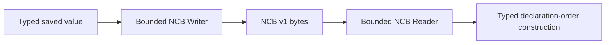

# neocogi-com-core

The C-shaped ABI shared by generated contracts, hosts, plugins, and the process
runtime. Its default configuration is allocation-free; optional `alloc` helpers
own decoded values and binary documents. Most authors use the `neocogi-com`
facade. The [current object ABI](../docs/README.md) remains experimental.

Core defines statuses, GUIDs, exact signatures, typed metadata, raw object/table pairs
and vtables, `IUnknown`, `ComPtr`, and `ComRef`. `ComInterface` owns identity and
the minimum threading promise. `ComFactoryInterface` marks interfaces eligible
for plugin bootstrap; `ComFactoryImplementation` associates private factory
storage with that interface.

A contract crate generates Rust bindings and fixed signatures. It has no native
module-description library or runtime registry entry. The IDL build helper hashes
the complete transitive graph and derives each declaration's final 32 bytes.
Core compares those bytes at factory/interface boundaries and does not hash or
reconstruct an IDL graph.

Plugin descriptor ABI v1 publishes plugin identity/version, hard dependencies,
full root-factory IID/signature, threading, and one zero-argument bootstrap.
Its getter is `nc_get_factory_plugin_description_v1`. Runtime discovery is v1,
with operation, plugin-registry, inspection, debug, and persistence tables. See the
[ABI specification entrypoint](../docs/README.md) for layouts and ownership rules.

## Interface safety

`ComInterface` is an unsafe extension point: implementing it certifies handle/table
layout, vtable prefix, exact identity, lifetime, and shared lifecycle calls.
Generated interfaces provide the normal implementation.

| Handle | Owns a reference | `Send` / `Sync` |
|---|:---:|:---:|
| `ComPtr<T, ThreadLocal>` | Yes | No |
| `ComPtr<T, ThreadSafe>` | Yes | Yes |
| `ComRef<'a, T, ThreadLocal>` | No | No |
| `ComRef<'a, T, ThreadSafe>` | No | Yes |

The interface states a minimum promise; a particular implementation may support
a stronger capability. Pointer markers preserve that implementation guarantee.
A thread-safe view may be weakened safely; no safe API upgrades a local view.

`ComDeserialize` is typed local source decoding. It does not use `Any`, an erased
value tree, descriptor-offset mutation, or a runtime type registry.

Core is `no_std` by default. `alloc` enables owned decoding/diagnostic helpers;
`std` implies `alloc`. Loading, process state, object allocation, and deployment
policy belong in other crates.

## Recursive checked values

`ComValue` separates application data from raw wire fields and typed producer
storage. `NcValueRef::new(&value)?` keeps that storage alive through a synchronous
call; `to_owned()` recursively checks fields and acquires receiver-owned data.
`ComInlineValue` additionally permits self-contained copied results and buffers.
Booleans and enum tags are validated before typed values are constructed, even
inside nested ordinary records. Numeric buffers can borrow in place only when
all fields prove identical layout and unrestricted contents. See the normative
[recursive value contract](../../../docs/contracts/RECURSIVE_VALUE_CONTRACT.md).

## Descriptor text validation

COM owns the shared descriptor grammars, exposed through both `neocogi-com-core`
and the `neocogi-com` facade. The validators allocate nothing, work without
`std` or `alloc`, and may run in const contexts. Their concrete error enums
report lengths or offending byte offsets; consumers add source/manifest context.

- `validate_qualified_name` checks logical descriptor names, including the
  existing dotted/colon-separated identity syntax. These are not Rust paths.
- `validate_version_text` checks bounded diagnostic version text.
- `validate_rust_path` checks advertised Rust module/type locations: 1–1024 ASCII
  bytes, optional leading `::`, and nonempty `::`-separated identifiers. Raw
  identifiers such as `api::r#type::Event` are supported. Bare `_`, Rust-2024
  strict/reserved keywords without `r#`, and `self`, `Self`, `super`, or `crate`
  even with `r#` are rejected. Weak keywords such as `union` remain valid.
  Whitespace, comments, Unicode, generic arguments, qualified-self paths,
  lifetimes and expressions are outside the supported binding-path grammar.

Use the Rust-path validator for both generated metadata and incoming catalogs;
consumers must not introduce another keyword list. The validator preserves the
input spelling; compiler consumers can normalize a leading `::` while making
syntax tokens. It does not resolve dependencies, check visibility or trait
implementations, or prove that a Rust type has a particular COM identity.
Rust compilation and the normal COM interface checks retain those responsibilities.
No Rust parser is linked into runtime users of these validators.

## Text, bytes, and borrowed storage

These types have different ownership and conversion rules:

| Type | Conversion | Ownership and validation |
| --- | --- | --- |
| `NcStaticUtf8` | `unsafe as_str<'a>(self) -> Result<&'a str, NcStatus>` and `unsafe as_bytes<'a>(self) -> Result<&'a [u8], NcStatus>` | Borrows descriptor storage; the caller establishes memory validity and the returned lifetime. `as_str` validates UTF-8. |
| `NcUtf8View` | Public `data: *const u8`, `len: usize`, and `EMPTY`; no conversion methods | Runtime-owned bytes with an externally specified lifetime. The facade copies inspection text into owned strings. |
| `NcAbiSignature` | `unsafe as_digest<'a>(self) -> Option<&'a [u8; 32]>` | One nullable pointer to a fixed digest. `from_static` requires a static 32-byte array; `EMPTY` explicitly represents absence. |
| `NcCopyFromBufferOffset<'a, T>` | `as_slice(&self) -> &'a [T]` | Holds an actual Rust slice. The logical offset does not slice or shift its storage. |
| `NcOutputWriter<'a, T>` | `push`, `extend_from_slice`, `forward` | Provider writes fresh copied wire slots and never reads old contents. |
| `NcOutputBuffer<T>` / `NcOutput<'a, T>` | `output(offset, capacity)`; published `as_slice()` | Caller owns reusable result storage; only the successful initialized prefix is observable. |
| `INcStringAbi` / `INcBytesAbi` | Raw length, indexed-byte, and bulk-copy vtable operations | A COM reference retains the provider. Safe allocating conversions live in the facade. |

`NcStaticUtf8` uses a `u32` byte count. An empty view returns an empty slice/text
even with a null pointer; a nonempty null view returns `NC_E_POINTER`. Invalid
UTF-8 returns `NC_E_INVALID_ARG`. Neither check proves that another non-null
pointer is readable. Its `Copy` implementation copies only the pointer/count,
and the returned `'a` is chosen by the unsafe caller rather than tied to `self`.
The word “Static” describes metadata's intended lifetime in its owning module;
the value neither owns those bytes nor pins a shared library.

For a readable `NcCopyFromBufferOffset<u8>`, use
`core::str::from_utf8(buffer.as_slice())` when text is required. There is no
universal safe `as_str(&self) -> &str` on raw ABI views. See the
[facade's data helpers](../api/README.md#strings-and-byte-buffers) for owned copies.

## Experimental persistent values

`ComSerialize` streams explicit initialization records through the concrete
bounded `binary::Writer`. NCB is the supported persistence encoding; there is no
serializer-adapter trait or runtime format selection.
`ComDeserialize` takes the concrete `binary::Reader`. Generated constructors read
each field once in order. `Reader::record` and `Reader::sequence` lend one bounded
ordered cursor and check complete consumption; no record names, field indices or
duplicate-field state machine participate. Enum payloads are constructed directly
under their proper nested value scope, without generated temporary payload types.
The facade derives `ComSerialize` and `ComDeserialize` for owned records and
enums, including recursive vectors and named/tuple payloads. NCB writes fields in
declaration order and enum ordinals without names. This is value
serialization; opting a live object into persistence remains its provider's job.

`binary::to_slice`, `binary::from_slice` and `binary::encoded_len_with_limits`
work without allocation support for allocation-free values. `alloc` adds owned
strings/collections and `binary::to_vec`. All output modes use the same writer,
framing and budgets; a short fixed buffer returns an error and its partially
written prefix must be discarded. They use NCB version 1: a
four-byte marker, little-endian scalars, u32 lengths/variant ordinals, and
declaration-order record fields. usize/isize occupy eight bytes; reads check
the target range. No native padding, pointers, or ABI signatures are saved.
Record/variant schema evolution must be versioned by the enclosing object
record; a changed COM method does not change the binary initialization schema.

Decoding rejects trailing bytes, truncated data, invalid booleans/UTF-8/variants,
unknown record fields, and duplicate map keys. Limits bound document bytes,
container counts, recursive construction, and total decoded values. Missing
trailing record fields only work with explicit default-backed decoding.
The wire format is experimental and is not yet a promised long-term file ABI.

Owned sequence decoding caps initial reservation at 4 KiB regardless of the
advertised element count or Rust element size. Capacity grows only as typed
elements are successfully decoded, so malformed counts cannot force a large
eager allocation before the first element is checked.

Built-in persistence contracts live in `persistence`: provider traits, interface
markers, clients and metadata require neither allocation nor a runtime. With
`alloc`, the module also provides the portable `ObjectRecord` schema and limits.
The COM facade re-exports these contracts and supplies concrete-provider thunks.

The canonical IDL is `idl/neocogi/com/persistence/objects.ncidl`. Its built-in
bindings are checked in because core cannot depend on its own IDL compiler.
Verify them with `cargo test -p neocogi-com-macros persistence_bindings_match_idl`;
set `NC_UPDATE_PERSISTENCE_BINDINGS=1` on that command to regenerate both halves.
Changes to common canonical encoding must refresh these bindings even when the
persistence IDL and physical layouts are unchanged: their exact signatures include
the common grammar. Run the freshness test again without the update variable,
then `cargo test -p neocogi-idl --test persistence_peers`. That regression generates
the current NCIDL and exercises all three interfaces against checked-in providers
in both directions through real COM calls. The normal macro and IDL CI suites
include both checks.

### Why persistence is NCB-only

The local persistence contract deliberately supports one format. `ComSerialize`
and `ComDeserialize` remain typed traits for concrete values; their argument is
the NCB writer or reader, not another trait selecting an input/output format.
Application JSON files keep their concrete Serde codecs. Live plugin arguments
keep `ComValue`'s checked foreign representation. Neither of those contracts is
implemented by the persistence cursor.



The former abstraction had a real use. `ff372ecd` introduced typed generic
deserialization; `584b7b92` supplied a Serde-to-COM theme adapter that could read
named fields in arbitrary order. `229f175e` added positional NCB. Later,
`0ebca601` replaced the generic theme bridge with concrete Serde codecs, but left
the generic persistence protocol and arbitrary-field state machines behind.
`4f48700c` repaired NCB's encoder/decoder budget symmetry, which remains required.

The NCB-only implementation (`5e8e7304`, `3a3f0249`) removes `ComSerializer`,
`ComDeserializer` and the record/sequence/map/enum access traits. Generated
decoders now construct fields in order and match enum ordinals directly. There
is no field-index loop, duplicate-record-field flag, pending key/value protocol
or generated enum payload struct. A `Sequence` is just the concrete NCB cursor's
remaining count and a mutable borrow of its reader. Fixed arrays still use
initialization slots so partially constructed non-Copy elements drop safely;
those slots do not represent arbitrary field ordering.

For a required record `State { label: String, enabled: bool }`, the generated
construction has this shape (support paths shortened):

```rust
impl ComDeserialize for State {
    fn com_deserialize(reader: &mut Reader<'_>) -> Result<Self, Error> {
        reader.record(2, |fields| {
            Ok(Self {
                label: fields.next()?.ok_or_else(|| fields.error("missing field"))?,
                enabled: fields.next()?.ok_or_else(|| fields.error("missing field"))?,
            })
        })
    }
}
```

The count may not exceed two. Required fields must exist. With explicit
default-backed decoding, only a genuinely omitted trailing suffix keeps its
default: a count of one can omit `enabled`, but a count of two with no remaining
boolean byte is truncated input and fails. A present invalid boolean also fails.
Previously acquired owned fields drop normally if a later field fails. Maps
still reject duplicate keys because repeated keys are possible in NCB.

Custom codecs follow the same accounting rule as generated ones. The caller
enters a decoded value through `Reader::read`; its `ComDeserialize` method reads
children with `read` or `Sequence::next`. A transparent scalar wrapper delegates
directly to its scalar's `ComDeserialize` implementation to reuse the current
value scope. An enum's anonymous tuple/record payload enters one extra
`Reader::value` scope before reading its aggregate. Writer scalar operations
charge themselves; aggregate writers pair their begin/end operations and encode
each child once. Propagate any error and discard that document operation; these
cursors do not promise recovery after a partial read or write. Measurement runs
that same writer without storing bytes.

NCB version 1 and canonical IDL encoding v8 are unchanged by the persistence
simplification. Core ABI v16 subsequently replaces signature views only. The
codec's Rust traits/cursors never cross a plugin boundary; providers exchange
the existing C-shaped persistence handles and byte buffers. The removed
`sequence` and `rename_all` policies are rejected rather than silently ignored.
NCB uses declaration order and variant ordinals for derived enum payloads. IDL
scalar integer enums and flags retain their existing raw-integer persistence;
this change does not replace those integers with ordinals. Removing Color's authored
sequence policy advances that declaration from version 2 to 3 as required by
the [IDL version contract](../../../docs/contracts/IDL_MODULES.md#contract-changes-and-versions);
its field order and NCB bytes stay the same. Rebuild dependent contracts together.

This change does not make runtime persistence services optional. They have real
snapshot/restore consumers. Omitting those services from a deployment is a
separate, unmeasured capability decision that must preserve discovery and ABI
contracts across build flags. Source deletion alone is not a binary-size result.

### NCB specialization validation

Validation on `refactor/ncb-only-persistence` through `3a3f0249`:

| Boundary | Executed evidence |
| --- | --- |
| Codec and ownership | Full COM/core/macros/runtime suites: 273 passed, four existing ignored tests; golden bytes, malformed inputs, exact budget boundaries, partial-value Drop and real object snapshot/factory restore |
| Compiler | Full IDL suite: 131 passed; generated records/enums/recursive values, rejected retired policies and unchanged canonical fingerprints for unaffected declarations |
| Allocation-free use | Three core tests with default features disabled; generated `no_std`/no-`alloc` record and enum codecs executed using fixed buffers and measurement |
| Consumers | 21 UI-document and six theme-authoring tests pass, including exact-limit binary save/load and generated bindings; `cargo check --workspace` regenerates contracts and checks tools, widgets and examples |
| Independent plugins | Both `compatibility.py --suite cross-version` cases pass on Linux with Rust 1.98.1 and 1.101.0-nightly, differing panic/LTO/private-layout flags; separately built relocated artifacts exercise calls, events, persistence and release |

The compiler matrix qualifies those concrete configurations; it is not a claim
about untested targets or every compiler version. No matched deployment-size
measurement was made for this simplification. The focused regressions live in
[binary persistence tests](../api/integration-tests/binary_persistence.rs),
[core fixed-buffer tests](tests/binary.rs) and
[IDL capability proofs](../idl/tests/capabilities.rs).

### Binary resource limits

The encoder and decoder apply the same `binary::Limits` policy. For the built-in
and derived codec pairs, encoding a valid value successfully produces a document
that the matching decoder accepts under the same limits. Custom serializer and
deserializer implementations must describe the same schema and consume all its
members. Format/schema validation and provider activation remain separate checks.

- `bytes` bounds the complete encoding, including the NCB marker, lengths, and tags.
- `elements` bounds immediate sequence elements, record fields, or map pairs in
  each container. It is not a cumulative count across sibling collections.
- `values` bounds all scalar and container values throughout the document. A
  vector of N scalar elements costs N + 1; a map costs one plus its keys and
  values. Empty containers and zero-sized unit values still cost one each.
- `depth` bounds the number of values on a root-to-leaf path. A scalar or empty
  container root requires one; a nonempty vector of scalars requires two.

`None` costs one value; `Some(x)` costs one plus `x`. An enum costs one value,
with no additional payload for a unit case. Newtype cases contain their value;
tuple/record cases contain a sequence/record value and its fields. Text costs one
value and its bytes consume `bytes`; string lengths, enum tags, and presence tags
are framing, not extra values or depth levels.

`binary::encoded_len_with_limits` runs the same encoder without an output buffer.
It returns the complete encoded length or the same budget error and offset as
ordinary encoding. This supports admission before cloning large typed inputs;
there is no separate approximate size formula. User-written serialization code
can still allocate internally. Materialized output reserves fallibly and checks
its byte ceiling before requesting additional capacity.

`ObjectRecord::encoded_leaf_len` checks the exact envelope for a known state-byte
length and no persistent children. It shares the ordinary record field serializer
and counts a virtual byte sequence, without allocating placeholder state. UUID and
revision contents do not change their widths. Use it together with measurement of
the actual inner value; it does not validate that value or cover child records.

`Vec<u8>` always remains a collection: each byte consumes a value and an element
of that collection. In particular, `ObjectRecord.state` receives this accounting
even though its bytes may themselves encode provider initialization. A separate
opaque-blob type would require an explicit schema/codec operation; the current
codec does not implicitly convert byte vectors to blobs. A byte ceiling therefore
does not promise that every smaller document fits the other limits.


Concrete providers select one ownership policy. Shared ownership is the default;
`#[com_object(..., ownership = exclusive)]` and
`#[com_class(Contract, ownership = exclusive)]` select exclusive ownership.
Only that policy's constructors are generated: shared classes have `from_value` /
`from_value_cyclic` / `into_local`; exclusive classes have `into_box` /
`into_box_cyclic` / `into_local_box`. Factories always remain shared.

Exclusive providers use `into_box` / `into_box_cyclic` to construct a
non-clonable `ComBox`. `WeakComBox` caches its interface table and accesses the
provider through checked call entries, without promoting to a shared owner.
Factories can return boxes and containers can consume them through generated
ABI methods. Ordinary shared services continue using `ComPtr`. See
[the ownership rationale](../../../docs/contracts/EXCLUSIVE_WIDGET_OWNERSHIP.md).

## Lifetime failure categories

`NC_E_DROPPED` reports lost object ownership. `NC_E_CLOSED` reports a closed
service or channel whose COM object can still exist. A method can propagate
either from a dependency, so neither status identifies receiver lifetime. See the
[precise lifetime error contract](../../../docs/contracts/COM_LIFETIME_ERRORS.md).
