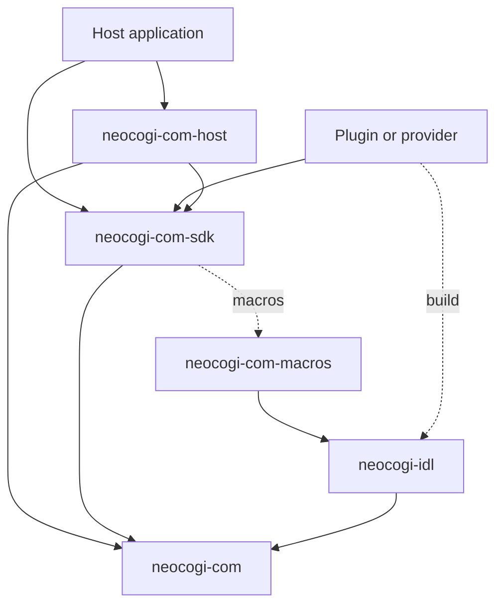

# NeoCogi COM

NeoCogi's component layer lets separately built Rust artifacts communicate
through an explicit C-shaped ABI. Rust-like IDL is the source of public contract
truth; generated COM interfaces carry calls, and plugins expose one typed root
factory.

SDK 0.5.0-wip-alpha.1 uses **WIP [ABI v4](abi.md)** with the
[current ABI versions](abi.md#abi-identities-and-versions). Its layouts and
callbacks are provisional and not frozen. Published 0.3.0 uses ABI v2/core
generation 19. Rebuild hosts, providers and generated bindings together when
adopting ABI v4.
Follow the [provider migration guide](guides/ABI_MIGRATION.md) for discovery and persistence changes.

## Rust names in 0.4.0

The `0.4.0` source uses these names. Update direct Rust imports
and regenerate bindings together; the previous names have no compatibility aliases.

| Previous Rust name | Current Rust name |
| --- | --- |
| `Runtime` | `RuntimeHandle` |
| `lifetime::NcClassLifetime` | `lifetime::NcObjectTypeInfo` |
| `NcAbiSignature` | `NcAbiDigest` |
| `serialization::scope::Lease<T>` | `serialization::scope::ScopedComWriteGuard<T>` |
| `serialization::scope::Scoped<T>` | `serialization::scope::ScopedComProvider<T>` |
| `serialization::Fields` | `serialization::RecordFieldReader` |
| `serialization::Sequence` | `serialization::SequenceReader` |
| SDK `Debug` | `RuntimeDiagnostics` |
| Host-internal `FactoryPluginRegistry` | `PluginRegistry` |
| Host-internal `RegisteredFactoryPlugin` | `RegisteredPlugin` |
| `neocogi_idl::AbiType` | `neocogi_idl::IdlType` |

The core `AbiType` trait and Rust's `std::fmt::Debug` trait retain their names.
The interface schemas, GUIDs, canonical digest bytes and encoding domains are
unchanged by these renames; the renames alone are Rust source API changes.
The separate lifetime-policy split changes C headers and type information,
introduced in ABI v3/core generation 21. Its ownership records are
`NcSharedLifetimeState` and `NcBoxedLifetimeState`; there is no fused
`NcLifetimeState` compatibility alias.

## Component model

```text
IDL module -> generated Rust types + exact transitive signatures
plugin     -> private implementations + descriptor for one typed root factory
host       -> compiles contract types and requests the exact factory
runtime    -> registers plugins, checks factories, retains loaded libraries
```

Contract sources are resolved at build time; generated interfaces, vtables,
metadata, and signatures remain in their consumers.
`interface` describes callable behavior and required projections. Implementations
own private Rust state through `#[com_object]`; `#[plugin]` publishes a typed
acquisition function. Ordinary methods construct parameterized objects. A domain
may define its own observer contracts using the same callable interfaces.

The [plain-Cargo sample](../examples/com-plugin/README.md) builds the same
plugin as a shared library and as an rlib statically linked into a monolith.

See [IDL contract modules](contracts/IDL_MODULES.md) for authoring and native
builds, [component design](architecture/COM_DESIGN.md) for responsibility
boundaries, and [the current ABI specification](abi.md) for the binary model.

## Hosts, callers and providers

A **host** is the final native executable or browser/Wasm assembly that selects
and initializes a linked `neocogi-com-host` implementation. Its Rust rlib,
`neocogi_com_host`, owns the plugin catalog, loading policy and host services.

An **interface caller** is any code that calls a COM
interface through a generated Rust interface wrapper, `ComPtr`, `ComRef` or another
appropriate handle. It can live in the host, a plugin, or an ordinary library.
Calling an object directly requires its
interface contract and handle, not plugin registration or a runtime lookup on
each call.

A **provider** implements interfaces and owns concrete object state. A **plugin**
packages a provider behind a descriptor and typed root acquisition function. A
plugin may be dynamically loaded or statically linked into the host. The same
provider can call another provider, so it is a caller during those calls. A host
that implements an observer callback is a provider of that callback interface.
These are roles in an interaction, not mutually exclusive kinds of Rust crate.

`neocogi-com` is the **portable base**. It defines the ABI records, typed
interface pointers, lifetime rules, value representations and serialization
traits. It can be used directly for ABI and fixed-buffer code.

`neocogi-com-sdk` is the **shared SDK** used by ordinary callers and providers.
It reexports those same types and adds concrete object helpers, owned bytes and
strings, optional macros and wrappers over host services. Its
`RuntimeHandle` copies access to the linked host's immutable C service tables.

### Dependencies

Solid arrows show Cargo dependencies. The dashed arrows mark optional macro
support and a consumer's build dependency.



| Assembly or package | Dependencies and purpose |
| --- | --- |
| Host application | `neocogi-com-sdk` with `runtime` and `macros` for runtime API wrappers and `com_main`, plus `neocogi-com-host` for the selected implementation. Static composition also adds the provider's rlib. |
| Plugin/provider | `neocogi-com-sdk` with the features needed for its objects and values. `macros` exposes `com_object` and `plugin`; `runtime` is needed only when it calls the supplied runtime API wrappers. It receives `RuntimeHandle` from bootstrap. |
| Ordinary interface caller | `neocogi-com-sdk` and its generated contract bindings, with `alloc`/`std` as its values require. Local interface calls do not need the host package or SDK `runtime` feature. |
| `neocogi-com-host` | `neocogi-com-sdk` with `default-features = false, features = ["std", "runtime"]` for ownership and host-facing wrappers; `neocogi-com` with `std` for raw service tables and validation. These dependencies identify one set of shared ABI types. |
| `neocogi-com-sdk` | `neocogi-com`, plus optional `neocogi-com-macros`. It has no host dependency, including when `runtime` is enabled or its unit tests run. Host-dependent integration tests live in the unpublished `tests/com` package. |
| Contract generation | A crate that generates bindings uses `neocogi-idl` in `[build-dependencies]`. The compiler itself depends on `neocogi-com`. Generated Rust uses `::neocogi_com_sdk`, so the consumer needs only the SDK as its normal COM dependency. |

The shared SDK remains usable with reduced features; all defaults disabled retain
its `no_std` interface/ownership surface. The host implementation requires `std`.
The Rust import roots are `neocogi_com`, `neocogi_com_sdk` and `neocogi_com_host`.

### Startup and calls

1. The final host explicitly depends on `neocogi-com-host` and uses
   `#[neocogi_com_sdk::com_main]`. The generated entry calls
   `neocogi_com_host::initialize_runtime()`, obtains an admitted `RuntimeHandle` and
   passes a `neocogi_com_sdk::RuntimeHandle` to the authored main body. Explicit
   `neocogi_com = path` selects an aliased SDK dependency.
   `neocogi_com_host = path` selects an aliased host or an initializer module.
2. The host registers a statically linked descriptor or loads an
   application-selected provider library. Registration checks the descriptor and
   dependencies before publishing the plugin in that host's catalog.
3. The host requests an exact factory interface. Acquisition validates the
   contract and invokes the provider's bootstrap with the same host API bundle.
   The provider receives its `RuntimeHandle` and returns one owning root
   interface reference.
4. The caller uses factory methods to create objects and calls their interfaces
   directly through generated method wrappers. Providers can retain supplied runtime
   access when they need host services or nested plugin acquisition; those calls
   return to the same host-owned tables.
5. COM handles govern object lifetime independently of catalog registration.
   Dropping a typed interface handle releases its ownership as defined by its interface
   handle. Dynamically opened provider code remains pinned for process lifetime,
   and the host's service tables remain valid after main returns.

For example, the [sample host](../examples/com-host) acquires the
[extent provider](../examples/com-plugin), calls its factory, and supplies an
observer. The host is the caller of the extent object; the extent object is the
caller of the host's observer. Both use `neocogi-com-sdk`. Only the final application
selects `neocogi-com-host`. Inspection tools may also depend on the host package
for its descriptor/loader utilities without initializing a second catalog.

## IDL

The COM-owned [IDL compiler](../crates/idl) generates checked ABIs for ordinary values
and callable interfaces. Domains can define their own observer contracts, as in
the [standalone example](../examples/com-plugin/README.md).

IDL declares public values and interfaces; the [language reference](contracts/IDL_MODULES.md)
owns the accepted syntax. Construction surfaces are ordinary interfaces. Concrete
classes and plugin acquisition are Rust implementation concerns. All IDL
declarations and members are public by definition:

<!-- checked-example: idl -->
```ncidl
struct Extent {
    width: u32,
    height: u32,
}

interface IMeasured {
    fn extent(&self) -> Result<Extent>;
}

interface ExampleObject: IMeasured {
    fn resize(&self, extent: Extent) -> Result<()>;
}

interface ExampleFactory {
    fn create(&self, extent: Extent) -> Result<ComPtr<ExampleObject>>;
}
```

The file path supplies the dotted module name. Declaration names preserve exact
casing, so `IWidget` in `neocogi/ui.ncidl` is `neocogi.ui.IWidget`.
Qualified names derive nominal identity without attributes; `#[id("UUID")]`
supplies an explicit one. Exact SHA-256 signatures detect contract changes.
An enum may select `u8`, `u16`, `u32`, `i8`, `i16`, or `i32` after its name;
the default is `u32`.

Each consumer is an ordinary Cargo crate with `build.rs`. The build helper tracks
the `.ncidl` source and transitive module graph, generates Rust bindings into
`OUT_DIR`, and publishes the graph through Cargo metadata. Ordinary Cargo
regenerates bindings after an IDL edit; no separate native artifact is built.

`neocogi_com_sdk::idl_metadata` supplies static descriptions that tools can read
without depending on the compiler. `InterfaceAbi::IDL_INTERFACE` describes
methods and their argument/result types; `Value::IDL_TYPE` describes fields,
enum cases or bit flags. These records stay local to their defining binary.
Domains own any transported catalog format and its application rules; see
[generated IDL metadata](contracts/IDL_MODULES.md#generated-idl-metadata).

## Implementing interfaces

`#[com_object(contract::Interface)]` associates private Rust storage with one
interface contract, including an interface whose methods create other objects:

<!-- checked-example: implementation -->
```rust,ignore
use neocogi_com_sdk::{ComPtr, NcStatus, com_object};
use example_contracts::*;

/// Private state; shared COM ownership protects its allocation.
#[com_object(example_contracts::ExampleObject)]
struct ExampleObjectImpl {
    /// Current dimensions read through IMeasured.
    extent: core::cell::Cell<Extent>,
}

impl IMeasured for ExampleObjectImpl {
    /// Copies the current dimensions through the declared value codec.
    fn extent(&self) -> Result<Extent, NcStatus> {
        Ok(self.extent.get())
    }
}

impl ExampleObject for ExampleObjectImpl {
    /// Changes this shared field through its Rust Cell.
    fn resize(&self, extent: Extent) -> Result<(), NcStatus> {
        self.extent.set(extent);
        Ok(())
    }
}

/// Stateless root with the generated supplied-host bootstrap.
#[com_object(example_contracts::ExampleFactory)]
struct ExampleFactoryImpl;

impl ExampleFactory for ExampleFactoryImpl {
    /// Publishes one explicitly owned interface with initialized private state.
    fn create(&self, extent: Extent) -> Result<ComPtr<ExampleObjectAbi>, NcStatus> {
        ExampleObjectImpl::from_value(ExampleObjectImpl { extent: extent.into() }).query()
    }
}
```

Interfaces own public identity, threading, callable methods, and required
projections. Implementations own fields and method bodies; factory methods are the only public construction path.

Objects exposing several independent projections may use
`#[com_object(interfaces(IFoo, IBar))]`. Generated storage supplies `IUnknown`,
reference counting, signature-checked `QueryInterface`, and call-access checks.
Use `&mut self` for mutation and keep ordinary state in plain fields.

## Publishing a plugin

<!-- checked-example: plugin -->
```rust,ignore
/// Acquires one initialized provider; returns its exact interface projection.
#[neocogi_com_sdk::plugin(name = "example.component", version = "1.0.0")]
fn acquire_root(_runtime: neocogi_com_sdk::RuntimeHandle) -> Result<neocogi_com_sdk::ComPtr<example_contracts::ExampleFactoryAbi>, neocogi_com_sdk::NcStatus> {
    ExampleFactoryImpl::from_value(ExampleFactoryImpl).query()
}
```

The plugin exports `nc_get_plugin_descriptor`. The descriptor includes the
native ABI version, plugin identity/version, hard dependencies, the complete factory
IID/signature, threading, and one bootstrap pointer. Static assemblies call
`plugin_descriptor()` directly. Both paths borrow the provider-authored
`NcPluginDescriptor`; neither acquires a factory. The runtime later returns
`PluginInfo` for inspection, adding registration origin and omitting bootstrap
code. Every shared object uses `from_value(initialized_value)`. The supplied-host
Rust acquisition function owns initialization and transfers one reference. A root
may be a finished service or an ordinary provider with typed creation methods.

## Host acquisition

For a monolith, enable `neocogi-com-sdk/runtime`, directly depend on
`neocogi-com-host`, and retain that implementation in the final assembly.
Register the linked provider before requesting its exact factory. The following complete function
accepts access supplied by the host entry and uses the declarations above:

<!-- checked-example: static-host -->
```rust,ignore
/// Executes bootstrap, construction, inherited reads and a mutable COM call.
fn static_example(runtime: neocogi_com_sdk::RuntimeHandle) -> Result<(), NcStatus> {
    let descriptor = plugin_descriptor();
    // SAFETY: linked plugin code and macro-generated static metadata remain
    // available for the process lifetime, including every returned COM handle.
    unsafe { runtime.register_plugin_descriptor(descriptor) }?;
    let info = runtime.plugin_info(descriptor.plugin_id)?
        .ok_or(neocogi_com_sdk::NC_E_NOT_FOUND)?;
    assert_eq!(info.factory.interface, descriptor.root_factory);
    assert_eq!(info.origin, neocogi_com_sdk::PluginOrigin::Static);
    let factory = runtime.acquire_plugin_root::<ExampleFactoryAbi>(info.plugin_id)?;
    let mut object = factory.create(Extent { width: 10, height: 20 })?;
    assert_eq!(object.extent()?, Extent { width: 10, height: 20 });
    object.resize(Extent { width: 44, height: 31 })?;
    assert_eq!(object.extent()?, Extent { width: 44, height: 31 });
    Ok(())
}
```

These four marked blocks are extracted verbatim by the IDL documentation test:
IDL resolution and Rust generation feed compilation of the provider, plugin
export, bootstrap and actual calls. The `ignore` fence here avoids pretending
that one Rust block can run without its preceding generated contract.

```sh
cargo test -p neocogi-tooling-tests --test documentation
```

Native hosts use `runtime.load_plugin_library(path)` for an application-selected
trusted library, then call `acquire_plugin_root` with its plugin ID. Loading
is unsafe because the library contains native code. The
[plain-Cargo example](../examples/com-plugin/README.md) covers full shared
and monolithic builds rather than leaving that deployment setup implicit.

Loading validates the factory descriptor and hard dependencies before one
atomic registration. Plugin dependencies must already be registered; the
runtime never discovers or recursively loads their paths. Required live-load
failure is diagnosed and aborts rather than exposing partial state. Successful
libraries remain mapped until process exit.

The runtime supplies one complete plugin-operation table, plus debug and
caller-scoped persistence tables. Lookup and enumeration return the same complete
plugin description, including its factory contract and dependency GUIDs. Loading returns the plugin GUID; inspection
reports its first static/dynamic origin. Separate module identities and module
queries were removed. See [the runtime contract](abi.md#runtime-and-global-registry).
Acquisition checks the exact factory signature before bootstrap. Unconnected
contract revisions can coexist; incompatible pointer transfers are rejected.
`neocogi-inspect` emits schema 11 with plugin/dependency/root-factory metadata,
without constructing objects. IDL tools retain build-time source inventories.

## ABI rules

- Interface calls are `extern "C"` vtable functions returning `NcStatus`.
- Compatibility requires both generated interface ID and exact ABI signature.
- `ComPtr<T>` owns one reference. `ComRef<'a, T>` borrows shared method access
  to a live interface for `'a`. `ComMut<'a, T>` borrows mutable method access
  and can lend a shared reborrow. Interface parameters restrict a loan to one call.
- Owners and loans use the same generated Rust method wrapper. Derived
  wrappers provide inherited lookup without generating another calling trait.
  These views are unsized, with private core storage: mutable lookup permits
  declared mutable calls but cannot replace the lender's object/table pair.
  Borrowing a view adds no lifecycle traffic. Wrapper references carry zero-length
  slice metadata; stored handles and C ABI pairs remain two words. Inherited
  views retain the original pair and threading capability, and use the checked
  base marker's wrapper association. An owned base projection requires a query.
- `Result<()>` lowers without an output slot; other successful returns write
  one explicit output slot.
- Copied records and payload enums use generated checked wire layouts.
- Variable-size values use call-scoped checked views that the receiver acquires;
  shared byte/string services can also cross as explicit COM owners.
- Borrowed bulk data uses explicit bounded pointer/count wrappers.
- Rust trait objects, `String`, `Vec<T>`, arbitrary references, allocator
  ownership, unwinding, and `Any` do not cross the ABI.

Object pointers record independent Send and Sync evidence. Local objects
grant neither. Combined evidence requires both. Generated safe Rust
enforces the lifetime of loans sent to scoped workers.

`neocogi-idl` computes one SHA-256 fingerprint from the canonical typed
module graph, derives a distinct signature for each declaration, and embeds
the final 32-byte values. rustc compiles those constants and the complete typed
descriptors; it does not serialize or hash contracts. Dynamic and monolithic
assemblies therefore perform the same exact identity and signature checks
without a validation-mode build setting.

## Typed value serialization

`ComSerialize` and `ComDeserialize` traverse local typed values through COM
`ISerializer` and `IDeserializer` objects. A shared `ISerializationFormat` factory
creates exclusive document sessions; `Format::new` selects an application or
plugin provider. `neocogi_com_serialization::ncb::format` selects the supplied
NCB implementation; the implementation rlib and thin dylib shim bundle optional
the optional `json` feature with unconditional NCB.
Generated records supply field names, and enum cases supply names and ordinals.
The same typed implementations support positional and named formats.

NCB conveniences preserve bounded, allocation-free fixed-buffer operations and
existing version-1 bytes. Owned cursors keep buffers behind COM ownership;
output and decoded strings use fresh caller-owned copies. The
[format contract](contracts/SERIALIZATION_FORMATS.md) owns lifecycle, limits,
errors and extensibility. [Object persistence](../crates/host/PERSISTENCE.md)
retains explicit reconstruction recipes and an NCB envelope by default.

## Crates

- `neocogi-com`: raw ABI layouts and traits (`no_std` by default).
- `neocogi-com-macros`: thin procedural entrypoints over IDL's shared backend.
- `neocogi-com-sdk`: typed object/data helpers and optional supplied runtime API wrappers.
- `neocogi-com-serialization`: reusable NCB/JSON codecs and static plugin descriptor.
- `nc-serialization`: thin native entry point for that rlib.
- `neocogi-com-host`: plugin catalog, loader, and persistence implementation;
  its Rust library target is `neocogi_com_host`.
- `neocogi-idl` under `crates/idl`: IDL parser/resolver, the shared `codegen`
  backend for contracts and Rust implementation macros, and Cargo build integration
  used directly by consuming libraries and applications.

The facade's defaults (`std`, `macros`) support local objects without linking a
runtime. `runtime` enables runtime API wrappers; every final native/browser host
explicitly links the `neocogi_com_host` rlib and supplies access to reusable libraries/plugins.
See the [feature and deployment table](../crates/com/README.md#features-and-scope).
The [core data guide](../crates/core/README.md#text-bytes-and-borrowed-storage) distinguishes
unsafe descriptor borrows such as `NcStaticUtf8::as_str` from owned string copies.

This runtime is trusted same-process native code, not a sandbox or plugin
marketplace. Applications own installation, trust, signatures, and path policy.

## Experimental object persistence and typed integration

`save_object_tree` serializes initialization data supplied by live COM objects.
`restore_object_tree` uses registered factories to reconstruct the tree.
The host/provider example reconstructs saved objects through a typed factory
and reconnects its application-defined observer.
[Persistence API](../crates/host/PERSISTENCE.md) · [Host/provider example](../examples/com-plugin/README.md)

## Executed compatibility checks

The [compatibility matrix](abi.md#independent-build-compatibility) defines independent host/runtime and
provider builds, mixed compiler/profile policies, relocated execution,
and the separate Miri/sanitizer checks. One unpublished Rust
[`xtask`](../tools/xtask/README.md) owns these checks on Linux, macOS and Windows;
CI invokes the same Cargo commands. An ordinary
`cargo build -p neocogi-com-host` produces its ordinary host rlib.
`#[com_main]` initializes that implementation; dynamic and static providers share
its registry through supplied C service tables. See the [native guide](guides/COM_NATIVE.md) for shared-provider and
monolithic builds.

## Checking the documentation

The complete maintained quality gate is `cargo xtask quality`.
It checks workspace formatting, all SDK targets/features with strict Clippy,
supported allocation modes, ABI snippets, local links and strict rustdoc. The COM
CI job runs that same task without dropping dependency lint coverage. Native
backend and cross-platform driver checks retain their separate CI rows.

Run these commands from the workspace root:

```sh
cargo test -p neocogi-com -p neocogi-com-sdk --doc --all-features
cargo xtask markdown
cargo xtask quality
```

The facade's runnable README examples participate in doctests. Examples marked
`ignore` are integration sketches requiring application-specific contracts or
plugin paths. `--all-features` leaves implementation selection with each final test owner;
the [plain-Cargo fixture](../examples/com-plugin/README.md) separately checks
real shared and monolithic deployments.
