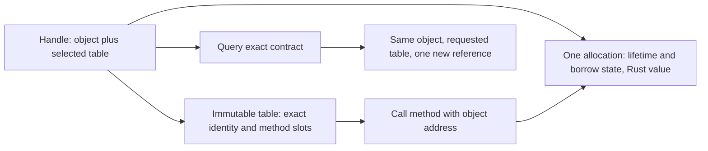
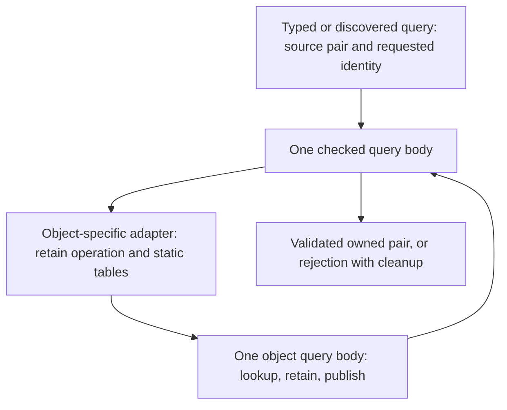

# COM object and interface storage

The current ABI uses **`{object, interface_vtable}` handles**. A generated object
contains one concrete Rust value and a common lifetime header. Shared objects keep
a separate call-borrow gate; exclusive objects combine owner presence and borrowing
in the header's atomic state. The [current ABI specification](../abi-v1.md)
defines both ownership policies. This guide explains interface storage; its size
tables record the named historical revisions, not current allocation costs.
Interfaces add no fields to each allocation. A handle selects a static table and
passes its object address directly to method, query, retain, and release slots.
There are no embedded interface headers and no owner offsets to recover.

The same decision and its rationale live beside `ComPtr` in
[ptr.rs](../../crates/core/src/ptr.rs). This guide expands the contract and records
the tradeoffs so a later review can evaluate them against evidence.

## Why this direction

The original generator embedded headers through every inheritance path, so a
shared ancestor occupied many physical slots in a repeated diamond. Flattening
the graph fixed that duplication, but the first implementation accidentally
retained full inspection descriptions in ordinary dispatch and grew the deployed
binaries by 152,200 bytes. That implementation was reverted. A later replacement
separated compact vtable selection from full descriptions and used one header
per distinct interface. An intermediate experiment reduced each header to a
single vtable pointer, with an owner displacement in the static table.

Those designs still made logical interface count determine object layout. They
needed initialization of every header, offset calculation, owner recovery, and
special care for inherited calls through derived table prefixes. Rather than
implementing C++ primary-base/header-sharing rules on top of that machinery, the
current representation carries the two addresses needed for dispatch directly.

This is an intentional 16-byte handle on 64-bit targets, not an accidental owner
cache beside an old interface pointer. The second word points to the **table**;
it does not point to an embedded header. Restoring thin handles would require
choosing and measuring another object/dispatch representation, not simply deleting
this word. Backward compatibility is not a constraint in this pre-alpha project.



Text equivalent: every handle names the shared allocation directly. Its table
selects the interface implementation; query changes that selection while keeping
the allocation address. No intermediate object header or address adjustment exists.

## Raw and safe representations

`ComRaw<T>` is a `repr(C)` record with fields in this order:

```rust,ignore
pub struct ComRaw<T: ComInterface> {
    pub object: *mut core::ffi::c_void,
    pub vtable: *const T::VTable,
}
// Raw synchronous dispatch; the caller keeps the pair alive and matched.
let status = ((*handle.vtable).set_text)(handle.object, text_wire);
```

`ComPtr<T, M>` owns one reference; cloning acquires one and dropping releases one.
`ComRef<'a, T, M>` borrows the same pair, with no implicit retain/release. The
reference count stays once in the allocation, never inside either handle.
Threading markers retain their previous meaning. There is no `Any` downcast,
Rust trait object, or runtime lookup of the concrete Rust type.

Raw optional absence is exactly `{null, null}`. Half-null records are malformed;
checked boundaries return `NC_E_POINTER` before dereferencing either word.
Safe handles use non-null fields, preserving two-word storage for their `Option`
forms. That Rust niche is not a promised foreign layout: use `ComRaw` at the ABI.
Raw copies do not acquire a reference or extend a borrow.

Erasing a raw table type to `ComRaw<IUnknown>` preserves the selected table's
identity. It permits common lifecycle dispatch, but does not prove the pair is
an IUnknown projection. This matters at plugin bootstrap: it transfers an erased
interface view, the runtime validates/returns the factory view, and typed factory
clients adopt it directly. Clients asking for IUnknown query that exact contract.

The [COM ABI v1 contract](../abi-v1.md) specifies this layout,
calling convention and ownership behavior. Discovery checks that baseline before
acquisition; exact interface signatures additionally select the callable contract.

## Compilation, queries, and borrowed inherited methods

Rust constant evaluation merges each parent's already-deduplicated interface
set, including imported contracts. Repeating an IID with another signature fails
compilation. Typed `VtblFor<Implementation>::PROJECTIONS` select methods for the
exact concrete value type. The compiler emits a static vtable-pointer array;
query scans the exact identities already in those tables. No runtime ancestry
walk, header array, descriptor graph, or redundant identity table is needed.

A successful shared-owner query transfers exactly one reference and returns the same object
address with the requested table. An absent IID returns `NC_E_NOINTERFACE`; a
matching IID with a different signature returns `NC_E_ABI_VERSION`. Failure clears
both output words. Typed clients also reject a returned different object and
release its transferred reference. For exclusive objects, `ComBox::query(self)`
moves the sole owner, `query_ref(&self)` borrows a projection, and
`query_weak(&self)` creates a weak observation. None duplicates the owner.
Object address determines allocation identity;
GUID plus signature determines interface identity. Table-address equality is not
a substitute for contract validation.

A first-parent client can borrow the physical prefix of its derived vtable for
method lookup. It retains the derived pair and cannot convert that borrowed view
into an owned base reference. Querying the base obtains its exact table. Static
inherited method entries still occur in derived tables: eliminating object headers
does **not** deduplicate those entries. Any proposal to change that is separate
and must preserve inherited dispatch and inspection.

Explicit interface metadata exposes physical method descriptors and exact
signatures. Ordinary construction and dispatch need not retain their descriptive
names. The [release-link regression](../../tests/com/integration-tests/projection_metadata.rs)
checks ordinary dispatch and explicit descriptor inspection separately. The
[source metadata contract](RECURSIVE_VALUE_CONTRACT.md#com-inspection-graph)
describes the local Rust value graph and its consumers.

All calls reach one generated shared/exclusive borrow guard. Mutable methods use
`&mut self`; concurrent or reentrant conflicting calls return `NC_E_BUSY`. The
existing `UnsafeCell` and guard are needed because independently owned COM handles
can alias one allocation.

## Historical storage tradeoff at the object/table migration

For a five-interface object on a 64-bit target, with `H` separately stored handles,
excluding Rust state, allocator bookkeeping and static tables:

| Representation | Object control/header bytes | Bytes per handle | Combined bytes |
| --- | ---: | ---: | ---: |
| Earlier two-pointer embedded headers | 96 | 8 | `96 + 8H` |
| Previous one-pointer embedded headers | 56 | 8 | `56 + 8H` |
| Initial object/table handles | 16 | 16 | `16 + 16H` |

Removing five headers saves 40 bytes per object; every stored handle costs 8 extra
bytes. This part breaks even at five handles. Handles **inside application state**
also grow, so complete object-size changes cannot be inferred from the control
area alone. Alignment, other allocations, handle arrays and method arguments
must be accounted separately. Safe optional handles remain two words.

The repeated-diamond fixture has sixteen contracts including IUnknown. Its
interface fields once occupied 4,096 bytes, later 256 bytes with unique two-word
headers, then 128 with one-word headers. They now occupy **zero**. Its static
contract/table set is still proportional to the unique contracts. Query work
remains linear in that set; ordinary dispatch has no lookup or owner adjustment.

The representation simplifies layout and dispatch. It does not guarantee smaller
binaries, faster queries, faster rendering or less total application memory.
Future reviews should measure handle populations, actual allocations, compiled
sections and relevant workloads before proposing another representation.

## Historical measurements

All figures below are deployed executable plus six shared libraries, excluding
assets, system libraries, and duplicate runtime link-directory copies. They are
historical measurements, not claims about current source.

| Checkpoint | Total bytes |
| --- | ---: |
| Fresh rollback baseline | 1,561,536 |
| Compact canonical two-pointer headers | 1,547,600 |
| Same headers plus separate codec optimization | 1,482,544 |
| One-pointer headers and static owner offsets (`1129d592`) | 1,479,896 |

These historical stages had not achieved the requested 1,400,000-byte
deployment target. Raw run archives are excluded from Git.

## Initial object/table measurement

The size measurements below refer to the former `libnc_com.so` runtime artifact.
The current `neocogi-com-host` implementation is an rlib linked into the final
host; these historical names do not describe a deployed host shared library.

Implementation `e428471a` was compared with a fresh build of `1129d592` at the
same workspace/output path using `rustc 1.100.0-nightly (bff8e12ff 2026-08-26)`,
full/Vulkan assembly and the min-size profile. The complete migration measures:

| Artifact | Previous headers | Object/table handles | Change |
| --- | ---: | ---: | ---: |
| `libnc_com.so` | 45,944 | 46,456 | +512 |
| `libnc_gfx.so` | 260,264 | 261,488 | +1,224 |
| `libnc_render.so` | 180,504 | 181,344 | +840 |
| `libnc_skin.so` | 221,904 | 223,144 | +1,240 |
| `libnc_ui.so` | 219,344 | 223,640 | +4,296 |
| `libnc_ui_nodes.so` | 343,824 | 347,144 | +3,320 |
| `neocogi-demo-full` | 208,112 | 221,304 | +13,192 |
| **Total bytes** | **1,479,896** | **1,504,520** | **+24,624** |

This is **1.66% growth**, and **104,520 bytes above 1,400,000**. The comparison
script's zero-growth check fails, as it should. The architectural decision accepts
that measured cost for this implementation; it does not redefine the target or
claim the size problem is solved.

Across these artifacts, `.text` grows by 19,793 bytes and `.rela.dyn` by 6,072;
`.rodata` shrinks by 1,064 and `.data.rel.ro` by 160. The executable accounts for
13,192 of the total 24,624-byte increase. These section totals locate the growth;
they do not prove a function-by-function cause. The comparison includes larger
handles throughout callers, direct object receivers, same-object query validation
and factory projection normalization. It does not isolate the cost of handle
width from those accompanying changes. The release-link test still verifies that
ordinary dispatch does not retain full inspection schemas.

The complete built-in allocations measured at `e428471a`, before weak lifetime
support and the later event-queue migration, were:

| Widget | Previous state | Current state | Previous allocation | Current allocation | Allocation change |
| --- | ---: | ---: | ---: | ---: | ---: |
| Button | 112 | 136 | 168 | 152 | -16 |
| Checkbox | 88 | 104 | 144 | 120 | -24 |
| Textbox | 184 | 200 | 240 | 216 | -24 |
| TextBlock | 72 | 80 | 120 | 96 | -24 |

All values are bytes on x86-64. State grows because it contains handles too;
object control shrinks to 16 bytes. Separate text buffers, resources, receivers,
allocator bookkeeping and external handles are excluded. The values therefore
support a specific allocation improvement, not a general application-memory claim.

Three interleaved runs of each query probe gave a **19 ns median for both builds**
after dropping each run's warmup. Remaining integer samples ranged from 18–21 ns
for the baseline and 18–20 for the candidate. These probes used the host's
`rustc 1.98.0` release profile, separately from the nightly deployment profile.
No query speedup is established; earlier measurements under different scheduling
conditions must not be compared as though they were this paired run.

Raw run archives are excluded from Git; repeat the workload before drawing
conclusions about the current implementation.

Validation passed 266 COM/core/macros/runtime/IDL tests, followed by a 31-test
runtime run adding one bootstrap regression; 85 widget/design tests; 24 offscreen
designer tests; 207 consumer tests and eight consumer doctests; and six native
deployment tests. Existing ignored cases remain recorded in the evidence.
Workspace all-targets checking, COM without default features, generated binding
consistency and the final optional-handle layout check also pass. A concurrent
Cargo build disrupted the first consumer doctest run; rerunning those doctests
alone passed without a source change. Cargo cleanup before the implementation
commit removed 16.6 GiB, and cleanup after it completed.

## Follow-up: avoidable code duplication

The 1,504,520-byte result above was a real regression. It was premature to treat
all of it as a cost of larger handles. A follow-up traced generated machine code
and tested changes independently, retaining the object/table ABI and its checks.

**Client query duplication.** `ComPtr<T>::query<U>` combined interface-specific
constants with query execution, exact identity validation, same-object validation,
and release on rejected ownership transfers. That made the common algorithm part
of generic callers. The implementation now supplies the source pair and requested
identity to one non-generic checked query body. Typed queries, discovered-interface
checks and factory activation reuse it. The type, lifetime, and threading contracts
of application handles remain unchanged; no application state becomes untyped.

**Generated object query duplication.** Removing object headers moved interface
lookup to static vtable-pointer arrays. Each concrete object's query implementation
then embedded its own table address. Those different constants prevented the
compiler from merging otherwise similar query bodies. In the executable's linker
map, generated object queries went from two merged functions totalling 186 bytes
to fifteen functions totalling 1,770 bytes. The generator emits small
adapters supplying ownership operations and tables to one common body.
The adapters total 495 bytes and the shared body 181. That body knows no concrete
Rust type or field offsets; the generated adapter remains responsible for layout.



Text equivalent: caller-side ownership validation and object-side interface lookup
are two separate operations. Each has one shared implementation; small typed
adapters supply the information that varies. `inline(never)` keeps those deliberate
boundaries from expanding back into every caller in this size-oriented build.

The independent full/Vulkan/min-size experiments used the same compiler, workspace
and deployment path:

| Change from the initial object/table build | Total bytes | Reduction |
| --- | ---: | ---: |
| Initial object/table ABI | 1,504,520 | — |
| Share typed client query body only | 1,496,280 | 8,240 |
| Share generated object query body only | 1,498,136 | 6,384 |
| Both changes | 1,489,912 | 14,608 |
| Also reuse checked query for discovery and activation | **1,489,768** | **14,752** |

The combined effects are measured directly, not obtained by adding isolated
savings. Across the seven artifacts `.text` shrinks by 14,765 bytes; `.rela.dyn`,
`.rodata`, and `.data.rel.ro` are unchanged by these query changes. Alignment and
other ELF details explain why the file reduction differs from `.text` alone.

| Artifact | Before follow-up | After follow-up | Change |
| --- | ---: | ---: | ---: |
| `libnc_com.so` | 46,456 | 46,376 | -80 |
| `libnc_gfx.so` | 261,488 | 260,160 | -1,328 |
| `libnc_render.so` | 181,344 | 180,608 | -736 |
| `libnc_skin.so` | 223,144 | 222,456 | -688 |
| `libnc_ui.so` | 223,640 | 221,096 | -2,544 |
| `libnc_ui_nodes.so` | 347,144 | 341,688 | -5,456 |
| `neocogi-demo-full` | 221,304 | 217,384 | -3,920 |
| **Total** | **1,504,520** | **1,489,768** | **-14,752** |

This recovers about 60% of the original increase. It remains **9,872 bytes above**
the 1,479,896-byte thin-handle build and **89,768 above** the 1,400,000-byte target.
The remaining section differences versus that thin-handle build include 5,028 more
bytes of machine code and 6,072 more bytes of dynamic relocation records, offset
partly by smaller constant sections. They do not establish that all remaining
growth is unavoidable.

The largest executable function, `app::create`, grew from 42,005 to 50,347 bytes
in the ABI migration and is now 49,184 bytes. This function includes inlined
construction and handle operations. Its size locates an area for further study;
the map alone does not attribute every added instruction to handle copying.
The thin-handle map came from a detached checkout and reproduced the executable's
file and `.text` sizes. Its binary hash differed, so it is used for symbol-level
attribution only. Full deployment deltas above use the original captures at the
same workspace path. The new ABI correctly rejected the old plugin descriptions
when the current packaging tool reached inspection; that experiment did not
replace the staged deployment.

### Separate linker experiment: packed relative relocations

The current binaries contain 81,360 bytes in `.rela.dyn`. Many entries tell the
loader how to adjust addresses in static tables. This is on-disk loader metadata,
separate from the two words stored in a live `ComPtr`.

Appending `-Wl,-z,pack-relative-relocs` at link time reduces the total to
**1,415,448 bytes**, another **74,320-byte reduction** from the fixed query build.
The aggregate `.text` size remains exactly 1,188,268 bytes. `.rela.dyn` falls to
5,184 bytes and a compact `.relr.dyn` occupies 824 bytes. All six plugin descriptions
were successfully inspected during packaging on the current glibc 2.39 host.
This experiment did not run a rendered application session.

**This flag is not enabled in the committed preset.** It requires a loader that
supports RELR: glibc added support in 2.36, and the linker adds an explicit
`GLIBC_ABI_DT_RELR` dependency. See the [GNU linker option](https://sourceware.org/binutils/docs/ld.html)
and [glibc support announcement](https://sourceware.org/pipermail/glibc-cvs/2022q2/078146.html).
That deployment requirement should be made explicit when adopting the flag.
Packing would also benefit the old ABI; it is a separate linker improvement,
not evidence that wider handles reduce code size. Even this experimental result
remains 15,448 bytes above 1,400,000.

The implementation is commit `4101e288`. It passed 267 COM/core/macros/runtime/IDL
tests, 85 widget/design tests, 24 offscreen designer tests, workspace all-targets
checking and COM without default features. The suites retain wrong-object and
wrong-contract rejection, malformed-pair checks, exact ownership accounting,
diamond queries, native C calls, dynamic factory loading and metadata isolation.

**Measured speed cost.** Three interleaved runs of the host release query probe
show a median increase from **19 to 30 ns** per raw query plus release. Remaining
samples after warmup span 18–23 ns before and 29–32 after. This probe directly
calls the object's raw query slot and bypasses typed client validation. Sharing
the generated object query is therefore a size/performance tradeoff in this
workload, not a free optimization. No application frame-time measurement was made.
The code-size result must be assessed with this slowdown visible.

A separate Cargo Bloat/disassembly investigation attributed the remaining
9,872-byte increase. Its broad acquisition-outlining experiment increased text
by 2,356 bytes and was reverted; this is not a blanket recommendation to outline.

## Verification and reproduction

Tests cover all query pairs in a repeated diamond, exact contracts, one final
destruction, one shared borrow guard, aligned generic state, inherited calls,
optional malformed pairs, returned object substitution and failed adoption.
Native C tests exercise by-value borrowed pairs, owned result pairs and lifecycle
calls. Dynamic plugin fixtures exercise discovery and factory normalization.
Compile-fail tests retain unsafe-interface, lifetime and threading requirements.

Use the same workspace path, compiler, profile and features for size comparisons.
Reproduce historical deployment totals using their recorded revision, toolchain
and application workload; the workflow at `531e1416` includes its original
assembly command. Current SDK builds use [plain Cargo](../guides/COM_NATIVE.md)
and include this query-only probe:

```sh
cargo run --offline --release -p neocogi-com-tests --example query_cost
```

The query probe rotates five contracts and balances each successful query with
Release. Interleave old/new binaries and discard each run's warmup. These samples
measure query plus release, not application throughput. Save logs/binaries outside
`target` before the required Cargo cleanup before and after every commit.

## Shared weak lifetimes

Shared objects use strong and weak reference counts. Exclusive objects have one
owner and may expose weak observers. Applications select their ownership policy;
the [ABI specification](../abi-v1.md#weak-lifetime-references) defines both policies.

The strong object/table handle remains two words; a weak handle now contains one
control pointer. Generated allocations use the common COM header in place of
private Arc storage. One immutable class descriptor supplies typed destruction,
allocator-local freeing and interface projections. All generated interface tables
point directly to the same query, strong retain/release and downgrade functions;
weak retain/release/upgrade likewise use non-generic functions. No weak operation
table or per-type counting wrapper is emitted.

The header adds one class pointer relative to the former Arc header, while each
weak handle saves one pointer. Concrete-value alignment can introduce padding;
interface count still adds no per-object fields. Lifetime changes do not add a
call gate: the existing gate continues to enforce typed mutable/shared access.
Final strong release destroys the value and its resources, while weak owners keep
only the allocation capacity and class metadata alive. Objects always start from
initialized values; no cyclic constructor or rollback protocol exists. Exact
promotion semantics are specified in [ABI v1](../abi-v1.md#weak-lifetime-references).

A historical matched full/Vulkan comparison reduced deployment from 1,536,440 to 1,505,688 bytes: 30,752 fewer bytes (2.00%).
Instruction/table/relocation changes and allocation-header costs remain distinct
from process memory. Historical tables above remain measurements of their
named revisions; none promises that one-pointer weak handles recover the older
1.3–1.4 MB target.
