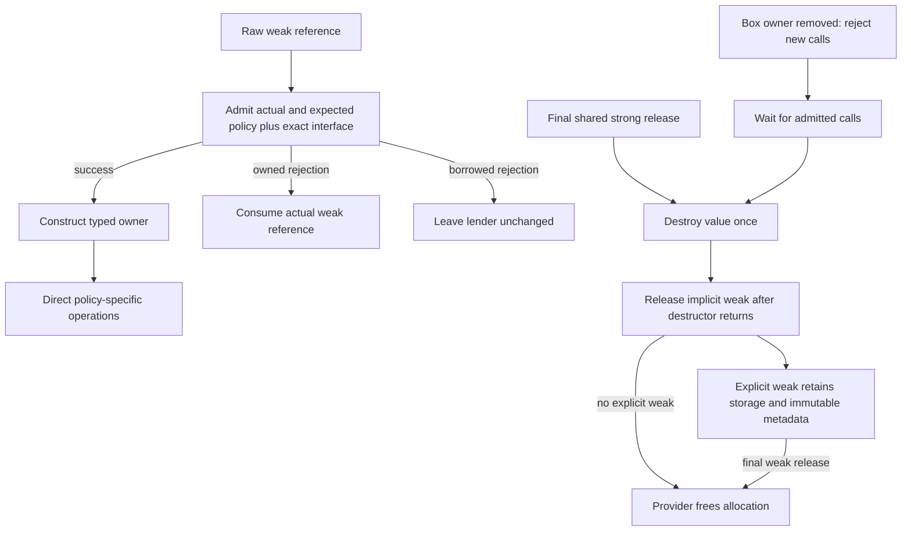

# Typed lifetime policy and raw admission

ABI v3 is WIP and not frozen. This contract narrows the provisional Rust provider
support APIs without changing the current three-word headers, C slots, core
generation 20, IID/digest identities, IDL v14 or NCB-v1 encoding.

Shared and boxed states have separate responsibilities. Shared `strong_count`
contains only a number; boxed `owner_and_borrows` atomically combines sole-owner
presence with admitted readers/writer. Each has its own weak count. The immutable
metadata tag is read at mixed-policy raw admission, not on ordinary typed operations.

## What establishes a policy proof

Generated construction selects concrete storage, metadata and root callbacks
together. A checked raw boundary validates before constructing its owner. An
unchecked unsafe constructor instead requires the caller to prove genuine layout,
ownership transfer, exact interface, threading permission and retained backing.
A raw `.cast()` changes a pointer type; it does not inspect or prove its allocation.

Once established, typed clone/drop/cast/promotion and matching policy-specific
callbacks use their own state directly. `BoxRead::enter`, `BoxWrite::enter` and
`try_box_cast` require genuine complete boxed storage. Their former mixed-policy
rejection promise is superseded by this WIP contract. Null remains an error input;
real owner-presence and reader/writer admission checks remain mandatory.

| Boundary | Input proof | Validation/acquisition | Failure ownership |
| --- | --- | --- | --- |
| Typed state/handle or matched vtable callback | Matching allocation policy, metadata/code and required owner retained | Direct selected counters or exact lookup; real live/borrow checks | Follow that operation's reference-transfer rule |
| Checked owned weak output | One complete retained shared or boxed header with truthful known metadata; boxed pair also has readable matching-provider table | Expected policy and exact allocation interface; supplied boxed table identity too; construct owner last | Consume one actual-policy weak reference |
| Borrowed weak wire | Readable common metadata retained through conversion; known kind promises its full matching header | Check policy/interface before retaining one independent weak; boxed wire resolves canonical table | Leave source reference/slot unchanged |
| Checked boxed owner output/input | Matching readable common-lifetime object/table and actual transferable owner | Incoming identity, boxed policy and canonical interface before adoption | Rejected output releases its actual owner vtable; rejected input slot stays unchanged |
| Generic strong/borrowed or scoped interface | Matching lifecycle table and lender/owner proof; no common header assumed | Actual virtual lifecycle/identity contract | Preserve that table's ownership semantics |

Generic `ComPtr` shared ownership semantics do not imply
`NcSharedLifetimeState` layout. Bytes/string and scoped providers are legitimate
headerless objects. A successful optional downgrade callback establishes the
shared weak protocol for its result; never read the original opaque object as a
common header to discover whether downgrade is supported.

Both-null and half-null boxed weak pairs transfer no token and return
`NC_E_POINTER` without reading either component. A cleanup obligation begins
only for a present pair with valid retained backing.

Unknown-kind metadata can be rejected after reading only its leading pointer and
the complete metadata record. No full policy header is borrowed first. Such a
prefix is a non-owning validation input, not a valid transferred weak reference:
it provides no known weak-count/cleanup protocol. An owned token must have a
complete matching header of one known policy. Checks do not authenticate native
providers, arbitrary addresses or truthful table/object pairing.

## Two raw boxed interface authorities

Boxed raw adoption and wire decode check the supplied table's IID and every digest
byte, then the allocation's canonical membership/identity. These answer different
questions: a good canonical table cannot excuse a stale supplied identity, and a
good supplied identity cannot invent canonical allocation membership. Success
retains the canonical provider table. Equivalent copied tables with equal identity
may succeed; table addresses do not define interface identity. Typed query already
has its source proof and only needs exact target lookup.

## Value destruction and weak storage

The weak shell can outlive the application value. It permits exact metadata
lookup without promotion or value access. The implicit weak protects storage
through the destructor, including release of weak-to-self fields. Final weak
release uses provider-local deallocation exactly once. Releasing operations use
raw-pointer arguments so an `&self` argument is not protected across deallocation.
Guard value loans end before admission unlock; retained slot storage survives the
complete guard/drop call. Box owner destruction remains synchronous.

## Shared promotion

One non-generic typed Rust operation returns
`Result<Option<ComRaw<IUnknown>>, NcStatus>`. It first acquires a nonzero strong
count with Acquire CAS, then negotiates exact IID/full digest. Zero is terminal
and returns None before negotiation. Success transfers precisely that acquired
owner. Failure releases it using shared release; this rollback may itself be the
final strong reference after another owner drops, so it can run the destructor.

No foreign weak-upgrade callback remains between lookup and result construction.
There is no private C-shaped request/output handshake or duplicate revalidation
of its own selected table. Actual foreign QueryInterface results still require
their independent validation. Binding-owned C adapters translate Rust results
to status/output records and clear failed outputs at their own boundary.

Counter overflow remains non-unwinding fail-stop before mutation. Policy proof
does not replace numeric count checks, boxed live/access admission, shared borrow
gates, threading guarantees or provider code retention through final weak release.
