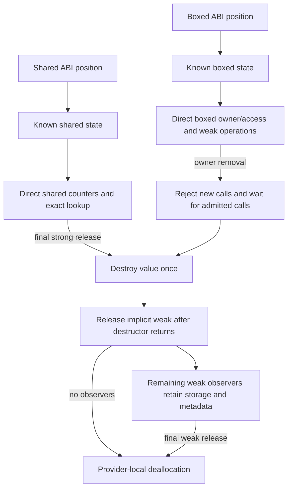

# Typed lifetime contracts

ABI v3 remains WIP. Core generation **21** removes runtime allocation-policy
discrimination and shrinks `NcObjectTypeInfo` from five to four pointer-width
words. Core 20 is incompatible and rejected before storage/callback use. The
three-word lifetime headers, C interface slots, IID/full digests, IDL v14 and
NCB-v1 document encoding are unchanged. Rebuild hosts/providers together.

## Ownership is a precondition

Shared and boxed states are distinct concrete types. Shared `strong_count` is
numeric; boxed `owner_and_borrows` combines sole-owner presence and admitted
readers/writer. Each has its own weak count. Neither mutable state nor immutable
provider metadata carries an ownership tag. `NcObjectTypeInfo` holds only exact
interface tables/count and provider-local destroy/deallocate callbacks.

Generated construction selects storage, callbacks and root prefix together.
An ABI method/value position declares shared versus boxed ownership. Its producer
must supply that matching backing, even when a client later rejects the interface.
The unsafe raw constructor contract makes the same obligation explicit. A pointer
`.cast()` changes a Rust pointer type; the surrounding contract proves its backing.

| Operation | Required proof | Checks and ownership |
| --- | --- | --- |
| Shared raw weak | `NcWeakRaw.control: *mut NcSharedLifetimeState` points to retained shared backing | Check presence/exact interface; failed owned adoption releases one shared weak |
| Boxed owner/weak raw pair | ABI producer supplies genuine boxed backing and a matching provider table | Check shape and incoming/canonical interface identity; reject through boxed owner/weak cleanup |
| Borrowed weak wire | Declared shared/boxed backing, metadata and source reference retained throughout | Validate interfaces before retaining one independent weak; failure changes no source count |
| Typed handle or matching callback | Construction, a valid owner or the unsafe matched-provider contract | Use its own state directly; no ownership classification |
| Boxed method entry | Retained boxed backing through the complete guard/drop call | Atomically check owner presence and reader/writer conflicts before any value loan |
| Generic strong/scoped interface | Matching lifecycle table and retained lender/owner | Use its actual vtable; no common allocation header is implied |

Wrong-policy tokens are ABI producer contract violations. There is no SDK
promise to accept, classify, reject and clean up a shared token as boxed or the
reverse. Earlier provisional mixed-policy contracts and their tests are
superseded. Do not reintroduce that promise through a helper, a metadata tag,
function-address comparison, or a second checked/trusted wrapper family.

Null/half-null boxed weak shapes transfer nothing and return `NC_E_POINTER`
without dereferencing either pointer. Present tokens require valid declared
backing. These checks do not authenticate arbitrary native pointers or providers.

## Interface validation is independent

A boxed raw pair's supplied table identity and the allocation's canonical
interface list are separate authorities. Validate the supplied IID/full digest,
then canonical membership and identity. Success retains the canonical table;
equivalent copied tables with equal identities are allowed. A stale incoming
identity cannot be replaced silently, and a correct incoming identity cannot
invent canonical membership. Policy is already established before either check.

## Destruction and weak retention

No branch determines whether one allocation is shared or boxed. Each operation
starts with that fact. Runtime liveness, borrow conflicts and count bounds remain
real uncertainties and are checked. Box destruction is synchronous. The implicit
weak protects storage through destruction of weak-to-self fields; final weak
release deallocates through its allocating provider exactly once.

Releasing operations take raw pointers so no `&self` argument remains protected
across freeing its allocation. Value loans end before guard unlock; retained slot
storage survives the complete guard/drop call. Interior mutability remains for
the actual COM aliasing/reentrancy boundary, not for discovering ownership policy.

Shared promotion acquires a nonzero strong count before exact interface lookup,
returning `Result<Option<ComRaw<IUnknown>>, NcStatus>`. Zero returns None before
negotiation. Failure releases its acquired shared owner; that rollback can be the
final owner after another release. Count overflow remains non-unwinding fail-stop.
Binding-owned C adapters translate the Rust result to their status/output slots;
there is no SDK weak operation table or erased promotion handshake.
