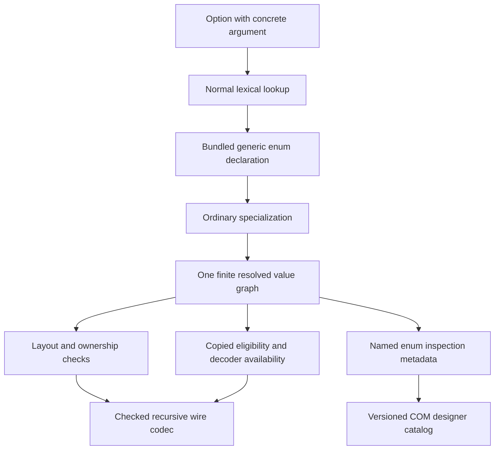

# Generic values, collection ownership, and the standard Option enum

This is the current contract. It replaces the former special `Option` type and
the context-dependent interpretation of `&[T]` fields. Backward compatibility
with those spellings/encodings is not provided; regenerate contracts and rebuild
all consumers.

## Which types the compiler understands directly

| Spelling | Meaning | Storage and use |
| --- | --- | --- |
| `ComPtr<I>` | Owned reference to a closed interface/class/factory | Stores a retained capability; does not store the implementation inline |
| `WeakComPtr<I>` | Shared weak reference to a closed interface/class/factory | Record/enum fields and method results; retains bookkeeping without retaining the value |
| `ComBox<I>` | Exclusive object owner | Explicit consuming method input/result; not an ordinary record/enum field |
| `WeakComBox<I>` | Weak observation of an exclusive owner | Method result and recursively borrowed record/enum fields; never persists the widget |
| `Vec<T>` | Owned collection of values | Record/enum fields; explicitly indirect, including recursive trees |
| `Slice<T>` or `[T]` | Unsized sequence referent | Cannot be stored in a record; must be borrowed for a call |
| `&Slice<T>` or `&[T]` | Readable call-scoped buffer | Elements must support recursively checked copied transport |
| `&mut Slice<T>` or `&mut [T]` | Fresh output-only call-scoped storage | Checked wire encoding writes directly; the caller validates only the reported prefix. Old values are not input. |
| `Array<T, N>` or `[T; N]` | Inline fixed-length collection | Copied arguments/results/fields/buffers when `T` is recursively copied |
| `Option<T>` | An ordinary enum from `neocogi.lang` | Follows exactly the same rules as any other generic enum |

`N` is a nonnegative integer literal fitting u32. This does not introduce user
const parameters or arbitrary const expressions. `Array<T, N>` and `[T; N]`
normalize before identities are computed, as do `Slice<T>` and `[T]`. A generic
`fn consume(&self, values: &T)` closed with `T = Slice<u32>` has the same input
buffer contract as an explicitly written `&[u32]`.

Ownership does not change with context: `values: &[u32]` is rejected as a record
field; `values: Vec<u32>` owns the collection. Arrays do not make an owning
element transferable as a copied result. For example, `Array<String, 2>` may
be stored in a named value borrowed during a call, but cannot be returned through
a copied output slot whose temporary text storage dies when the call returns.

`WeakComPtr<I>` can be nested in `Option`, vectors, arrays and generic values.
Such aggregates are borrowed during calls; they are neither copied buffer
values nor implicitly persistent. Direct weak method inputs are unsupported:
borrow a named record containing the weak handle. An expired shared weak token
is still a valid field/result, and promotion returns `None`.
`WeakLocalCom<T>` is a native Rust construction proof, not IDL syntax; expose an
interface projection as `WeakComPtr<I>` across the ABI.

## Option is library source

The compiler ships [this ordinary declaration](../../crates/com/idl/stdlib/neocogi/lang.ncidl):

```rust
#[version(3)]
enum Option<T> {
    None,
    Some(T),
}
```

It is implicitly available through the prelude. Explicit
`extern neocogi.lang; use neocogi.lang::Option;` or a qualified
`neocogi::lang::Option<u32>` selects the same declaration. Local declarations,
explicit imports, and template parameters shadow an unqualified prelude name.
`Option` is not a reserved keyword. The **module path** `neocogi.lang` is owned
by the compiler and cannot be replaced by a project module.

The library's source revision participates in fingerprints. Closed instances are
created by the ordinary specialization worklist, with the same depth/instance
bounds as application templates. Independent consumers agree on identity and
signature without sharing generated Rust definitions. Cargo and module tooling
recognize bundled source dependencies; no `neocogi-lang-contracts` package or
`DEP_*` graph is required.

There is no `AbiType::Option`, `ValueType::Optional`, or special optional metadata
constructor. `Option<u32>` is a named enum definition with `None` and `Some`
variants. The latter's field references `u32`. The same enum codec validates tags,
active fields, nesting, and resource use for application and library enums.



## Copied and owned optional values

```rust
#[version(1)]
interface IExample {
    fn exchange(&mut self, value: Option<u32>) -> Result<Option<u32>>;
    fn inspect_text(&self, value: &Option<String>) -> Result<()>;
    fn inspect_object(&self, value: &Option<ComPtr<IUnknown>>) -> Result<()>;
}
```

The first method copies a self-contained tagged value in both directions. The
other methods borrow the complete enum through `NcValueRef` for the synchronous
call. `to_owned()` validates the selected payload and acquires its independent
storage/reference before the producer's guard expires.

`Option<&I>` is rejected because ordinary value fields cannot store a borrowed
capability. Write `&Option<ComPtr<I>>`: the outer `&` is the call borrow, and
`ComPtr<I>` states what an acquired payload owns. Absence is the `None` tag, not
a nullable interface argument. A malformed tag is rejected before reading a
payload; `Some` requires a valid present COM capability. `Rc<RefCell<...>>` and
`Arc<RwLock<...>>` are not part of this boundary.

Generated concrete names retain the deterministic specialization suffix.
Copied and owned payload enums both use their native generated Rust type.
Copied methods accept/return that enum directly; no `...Abi` enum wrapper or
`.into()`/`try_into()` adaptation exists. Only `ComValue::Wire` crosses the
foreign boundary, with tag and active-field validation in generated calls.
Neither the native enum's layout nor Rust's built-in `std::option::Option`
niche/nullable layout is an IDL promise. Native Rust optional helpers used by
hand-authored COM APIs are separate from this ordinary IDL library definition.

The [compiled example](../../crates/com/idl/examples/generic_values.ncidl) covers
copied optional results, optional text, optional live capabilities, and readable
buffers of optional booleans.

## Parameter positions and contract signatures

Parameter names are local source names. The compiler fingerprints a reference
by its zero-based position in the template declaration, including references
inside nested generic arguments, arrays, collections, COM handles, enum payloads,
interface bases, and method types. The source model retains the authored names
and locations for diagnostics and substitution; fingerprinting does not rename
AST nodes or invent identifiers in the IDL language.

These alternative source revisions of the same declaration have identical
fingerprints. They are compiled separately, not placed together in one module:

```rust
// Before
#[version(1)]
struct Pair<T, U> { first: T, second: U }
```

```rust
// After: same module, declaration name, version and dependency revisions
#[version(1)]
struct Pair<Left, Right> { first: Left, second: Right }
```

Both descriptions encode `first` as parameter 0 and `second` as parameter 1.
Changing the latter declaration to `first: Right, second: Left` encodes the
opposite positions and changes the signature. This remains true for
`Pair<bool, bool>`: identical concrete field layouts do not erase a change to
the template contract. Unused parameters still contribute their count. Each
template has its own scope, and `library::T` remains a qualified free type even
when a template also declares an unqualified parameter named `T`.

| Change | Nominal identity / revision behavior |
| --- | --- |
| Rename a parameter and all its bound uses | Same IDs, module fingerprints, and closed signatures |
| Change which parameter a field, base, or method type refers to | Same closed nominal ID for unchanged template/argument IDs, different revision signature |
| Change a field/variant name, member order, or array length | Remains contract data; parameter normalization does not erase it |
| Change an unrelated declaration in the defining module | Still changes the module revision and dependent signatures |
| Change Rust output paths or parameter source locations | Does not enter the canonical contract identity |

The table distinguishes which information participates in hashing. Observing a
changed signature with an unchanged declaration ID does not authorize retaining
the old version after a contract edit. Contract changes require a declaration
version increment under the [versioning rule](IDL_MODULES.md#contract-changes-and-versions);
the parameter-binder rename above is an explicit exception because the binding
positions and uses are unchanged. An ordinary version increment changes the
template's nominal ID and consequently its closed nominal IDs as well.

Templates and concrete declarations share the canonical binary declaration
encoder under `neocogi-idl:module-abi:v12`; there is no separate template string
serializer or Debug-based policy encoding. Regenerate and rebuild consumers when
adopting this encoding. Nominal type IDs remain independent of the encoding
revision. Parameter-only renames preserve the resulting signatures. Direct generic
bases and emitted events follow the same binding rule as type expressions.
Revision v12 retains the framed bound/free reference slots and gives bound
parameters a type-expression tag distinct from output buffers. Invalid closed substitutions
remain source-level validation errors rather than internal fingerprint failures.

Both integer-enum paths encode whether a value was explicitly assigned, as well
as its resolved integer. An implicit-to-explicit edit therefore changes the
fingerprint even if an author mistakenly retains the version. The author must
still increment the declaration version; no historical release comparison is
performed. Payload enums reject all explicit assignments before specialization.
Authored persistent-format, dense-domain and naming policies use the same explicit tags
for templates and concrete declarations. Matching physical layouts never erase
these contract distinctions.

[Parameter-position tests](../../crates/com/idl/tests/generic_parameter_positions.rs)
compare independently resolved modules and signatures, exercise nested and
recursive values and interface positions, and verify that free names and source
binders are preserved. The [generated COM regression](../../crates/com/idl/tests/generics.rs)
compiles a producer with the original names and a consumer with renamed binders.
It negotiates an interface, round-trips a copied boolean record, and sends a
recursive enum event to the independently generated consumer sink. A third
binding changes parameter positions while keeping concrete fields identical;
COM negotiation must reject its revision with `NC_E_ABI_VERSION`.

## Recursion and deserialization

`Option<Node>` stores its selected payload inline. Therefore this is invalid:

```rust
#[version(1)]
struct Node { child: Option<Node> }
```

`Vec<Node>` provides explicit indirection, including inside `Option<Vec<Node>>`.
The compiler must not invent a box or another hidden indirection to repair an
infinite inline layout.

Persistence is automatic for every value whose reachable fields support both
`ComSerialize` and `ComDeserialize`. The same finite graph handles nested records,
arrays, vectors and recursive generic specializations. There is no decoder opt-in,
`if_supported` mode or separate “not requested” state. The old `#[deserialize]`
IDL attributes are rejected rather than retained as compatibility aliases.

- Records use named fields, all required by default.
- Payload enums use declaration-order tags and the active typed payload; unit,
  newtype, tuple and named cases share that variant protocol.
- Fieldless integer enums and bit sets use their declared integer width and
  preserve unknown raw values. They are numeric constants, not payload sums.
  Operation-specific validity checks still apply after reconstruction.
- `Guid` persists an exact 16-element sequence of canonical UUID bytes, never
  native struct memory. `Status` persists its raw signed 32-bit code, including
  extension codes. These recipes are symmetric and available without allocation.

Thus `Option<u32>` gains both persistence traits automatically, while
`Option<ComPtr<I>>` remains transportable but has neither persistence trait.
Recreating an implementation object requires an application reconstruction
contract. Rust rejects an attempted persistence call on such a specialization;
no field is skipped, fabricated or encoded as a process address.

Records may explicitly select `#[persistence(default)]` to retain a host-authored
Rust `Default` for an omitted trailing suffix. Every NCB record already reads and
writes fields positionally; `#[persistence(sequence)]` is rejected. The default
policy requires supported fields or IDL reports `EIDL064` at the field/closed use.
It applies only to records and enters the common contract fingerprint. Changing
an authored persistence policy requires a declaration version increment. The
renderer Color contract advances to version 3 when removing its sequence policy;
its four-byte-element NCB sequence representation remains unchanged.

These implementations are ordinary static Rust traits, not COM object classes,
vtables or factories. Automatic codec generation does not alter value ownership.
Object restoration, arbitrary const generics, borrowed stored fields, and ownership
transfer for returned vectors/text remain outside the supported value contract.

## Inspection and verification

COM designer catalog schema 5 transports optional values through ordinary named
enum definitions. Complete-definition, tag, and inline-cycle validation follows
the same graph as other values. Schema 4's separate `Optional` expression is
removed; an old descriptor is rejected by version instead of misinterpreted.
This does not add widget routing or additional event ports.

Permanent regressions are in [intrinsic tests](../../crates/com/idl/tests/intrinsics.rs),
[enum decoder tests](../../crates/com/idl/tests/enum_decoders.rs), and
[standard library tests](../../crates/com/idl/tests/standard_library.rs). They compile
generated Rust, call actual COM thunks, check malformed booleans/tags, exercise
both copied and borrowed ownership, build through Cargo with an explicit standard
import, and inspect the generated enum graph. The
[recursive value contract](RECURSIVE_VALUE_CONTRACT.md) defines wire memory
obligations, resource budgets, and the intrinsic array identity encoding.

## Reading generated specialization names

A generated `NameInstance<hex>` Rust identifier represents one **closed IDL type**,
including its template and type arguments. The suffix is the closed type's
nominal UUID in hexadecimal, derived from the template and argument identities.
It is not a reversible encoding of source text: demangling the hex yields UUID
bytes, not the argument list. Generated documentation therefore names the full
closed IDL type beside the Rust declaration. Use that comment or the generated
typed IDL metadata to interpret the name. This differs from Cargo `links` names,
whose hex suffix directly encodes the exact dotted module name and is reversible.
Neither presentation rule changes runtime/descriptor ABI v1.

## Free types across Cargo dependencies

A template's nongeneric references keep their lexical owner. If a bridge template
uses `leaf::Fixed`, closing that template in a consumer keeps the original leaf
Rust type even when the consumer depends only on bridge. Cargo generation selects
a typed re-export route through the direct provider, including for qualified free
names without `use`, and does not duplicate the leaf declaration. The
[Cargo dependency contract](IDL_MODULES.md#module-crates) describes provider
selection and the generated dependency namespace. Public owner metadata and
canonical signatures are independent of these consumer access routes.
