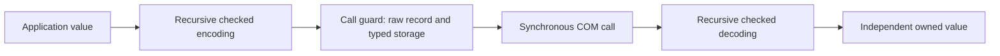
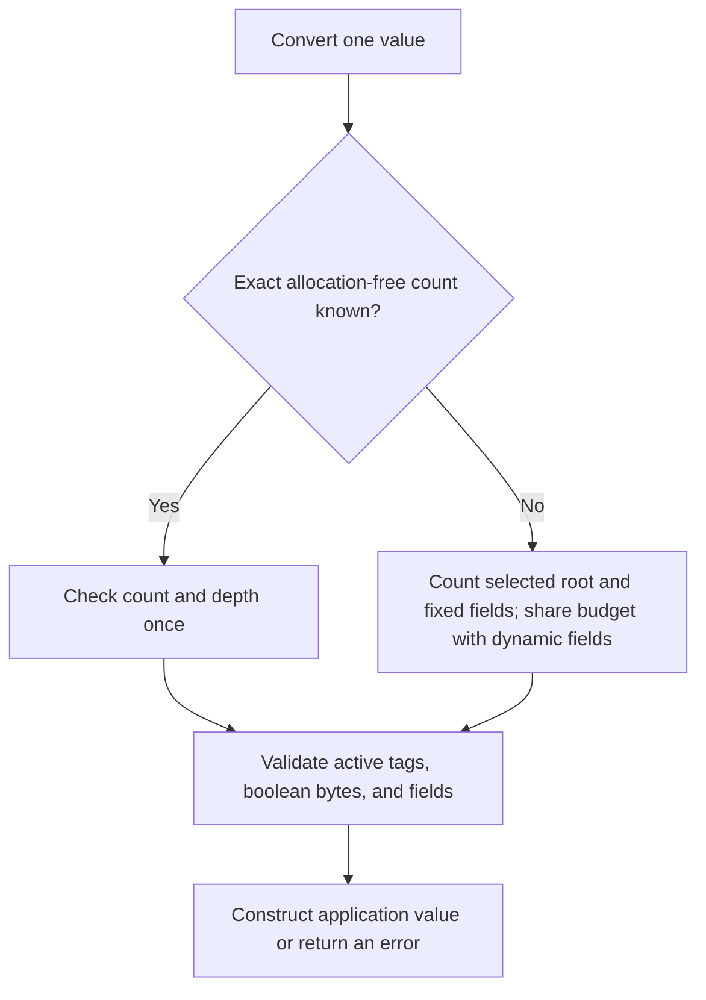
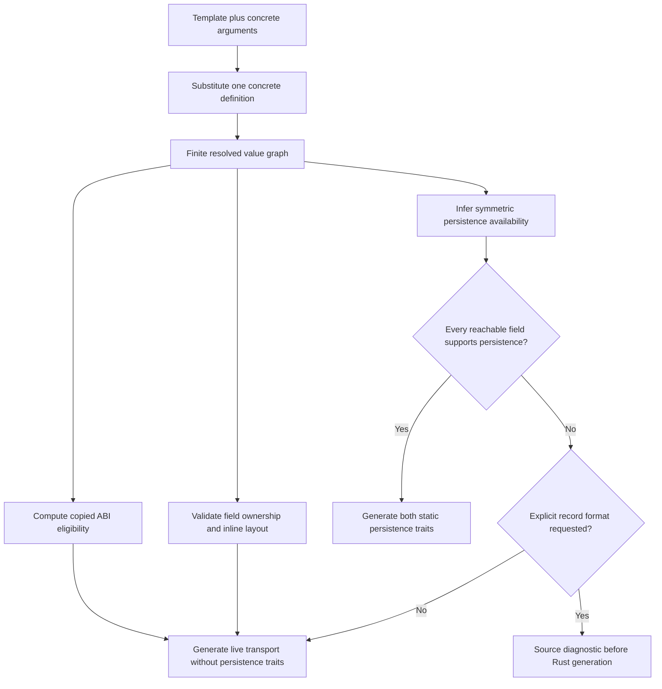

# Recursive IDL values and COM transport

## Normative model

IDL records and enums describe application data. There is no separate message
category. A message is an ordinary value used by an application's delivery
interface. Whether a field owns data follows its type, not an annotation on its
containing declaration. `ComPtr<I>` explicitly stores an owned COM capability;
`I` alone is an object contract, not a field representation. The same constructor
spells owned method results, while `&I` remains a call-scoped borrowed input.
`String` means text data; use `ComPtr<INcString>` for an owned COM string object.
`WeakComPtr<I>` retains shared lifetime bookkeeping without keeping the value
alive. It can be stored recursively in borrowed aggregates or returned directly;
its wire is `NcWeakRaw`. Acquisition validates shared ownership and the exact
interface, then retains a weak token without promotion. Expired tokens remain
valid transport values. Weak fields have distinct design metadata and do not
acquire copied-buffer or persistence capability. See [ABI v17](../../crates/com/docs/abi-v17.md#shared-weak-result-and-value-transport).

A value consists of scalar leaves or recursively composed aggregates: records,
tagged enum alternatives, fixed arrays, and sequences. `Option<T>` is a bundled
ordinary generic enum, not another aggregate category. Text is
UTF-8 byte storage. A sequence is a collection of values, including a sequence
of bytes; it is not implicitly an opaque binary blob.

Every boundary conversion follows the same rules:

* Booleans use raw bytes, and only 0 and 1 decode successfully.
* An enum uses an integer tag and raw payload storage. Decode matches the tag
  before reading the selected payload. Inactive payloads are never read.
* Records, arrays, options, and sequence elements recursively use these rules.
* Strings validate UTF-8 before acquiring owned text.
* COM references validate the complete interface identity and acquire a reference
  before the producer's borrowed reference expires.

Application values and wire values are different types. A wire descriptor never
points at application records whose layout or bit-pattern validity differs from
that of raw records. The synchronous call guard retains both the source borrow
and typed temporary storage for converted indirect elements. No `Any` registry,
erased allocation list, or shared mutable parent object is involved.



## Native copied enums

Generated Rust fields, parameters, results, and buffers use the native enum:
`Choice`, `[Choice; N]`, and `&[Choice]`. The only foreign representation is
`<Choice as ComValue>::Wire`: an explicit C record with the existing `i64` tag
and recursively lowered active payload. There is no `ChoiceAbi` application
wrapper, public `ChoiceTag`/`ChoicePayload`, or wrapper conversion API.
Interface markers such as `IWidgetAbi` remain a separate object contract.

Copied capability means the codec's wire is self-contained. It does **not**
promise stable native Rust enum layout. `AbiType` supplies nominal metadata;
`ComInlineValue` proves the codec's copied capability. Application-memory layout
tables are not published: concrete wire records, checked conversions, and the
recursive `BORROW_WIRE` proof own the foreign-storage contract. Generated calls
must continue encoding/decoding even when native and wire sizes happen to match.
This permits separately compiled libraries to use different Rust layouts.

Unknown payload-enum tags are expressible only in raw wire storage and fail
before the payload is read. Unit/integer enum newtypes retain their separate
open-integer policy. Semantic checks, such as nonnegative Grid extents, still
run after wire decoding. Neither signatures nor raw tag width change when the
obsolete safe Rust wrappers are removed.

## Synchronous borrowed parameters

IDL emits anonymous call-scoped lifetimes for borrowed COM inputs in generated
Rust declarations. A producer guard may borrow longer-lived native storage, but
the receiving method cannot retain its temporary wire or backing storage.

| Parameter | What the receiver borrows | Retention beyond the call |
| --- | --- | --- |
| `NcValueRef<'_, T>` | A checked value's raw record and producer-owned backing storage | Acquire `T` with `to_owned()` before returning. |
| `ComRef<'_, I>` | A live interface reference | Acquire shared ownership with `try_add_ref()?`; an exclusive borrow returns `NC_E_INVALID_ARG`. A threading marker does not grant ownership. |
| `NcCopyFromBufferOffset<'_, T>` | Readable elements for this call | Copy needed contents into owned application storage during the call. |
| `NcOutputWriter<'_, T>` | Fresh copied output on the provider | Encode directly into raw slots; never read old contents or retain the writer. Clients supply `NcOutput<'_, T>`. |

For example, a receiver may store an owned message, but never the borrowed guard:

```rust,ignore
// Part of a generated COM interface implementation; saved: Option<Message>.
fn retain(&mut self, value: NcValueRef<'_, Message>) -> Result<(), NcStatus> {
    self.saved = Some(value.to_owned()?);
    Ok(())
}
```

`Message { entries: Vec<String> }` needs a temporary array of raw string records
when encoded. Even if the original `Message` lives forever, that array belongs
to the producer's `NcValueRef` guard and can be freed when the call returns.
A producer guard created from a static source may therefore have a static source
lifetime, but the receiver must still borrow its encoding only for the call.
The receiver's `to_owned()` validates and acquires independent contents before
those temporary records expire. The same rule applies before enqueueing a value.
No extra runtime lifetime registry or C ABI change is involved.

## Layout and recursive ownership

Every inline dependency cycle is invalid, including cycles through `Option` or
fixed arrays. Mutual recursion follows the same rule as direct recursion. The
compiler must report this in IDL, rather than emitting infinitely sized Rust.
It must never insert hidden boxes to make such a declaration compile.

An explicitly indirect sequence can close a cycle. The resulting application
value is a finite owned tree. A raw producer can physically create a cyclic
pointer graph, but decoding it must exhaust the shared nesting/work budget and
return an error. Shared object identity and cycles belong to explicit COM object
references, not to copied aggregate ownership.

## Resource and memory obligations

A conversion carries one mutable budget through all children. It bounds storage
bytes, total visited values, and nesting depth. The defaults are 8 MiB, one
million values, and 64 levels. Empty aggregates and zero-sized elements still
consume work. Sequence allocation sizes are checked before allocation, and
allocation uses fallible reservation. Encoding charges both raw-element storage
and the guards retaining child allocations. Decoding charges acquired application
storage. Representation sizes differ, so these COM allocation budgets do not
promise identical acceptance at an exact byte threshold. Persistent binary
encoding and decoding have their separately defined symmetric structural limits.

Raw callers must supply initialized, aligned, readable, live active storage and
valid COM headers. A checked decoder cannot prove arbitrary address readability.
These obligations do not require a boolean byte or enum tag already to be valid;
the decoder checks those contents before constructing restricted Rust values.
The decoder must not inspect an optional or enum payload before validating that
its tag selects that payload.

A copied output slot may contain only a self-contained wire value. A wire that
borrows temporary storage cannot be returned after its guard is destroyed.
Unsupported ownership/use-site combinations must be rejected during IDL
resolution with source diagnostics, rather than during downstream Rust compilation.

## Counting work without repeating checks for every field

The limits describe accepted data, not a requirement to update a counter at each
machine instruction. Generated code can combine checks when it proves the same
value count and nesting depth ahead of time. It must still validate every active
boolean, tag, and other restricted field.

For example, `Flags { enabled: bool, visible: bool }` contains three logical
values: the record and its two fields. Its maximum depth is two. The compiler
records those numbers in `ComValue::FIXED_COST`. Conversion checks that three
values and two levels remain, then validates both raw boolean bytes. A byte of
`7` still fails; successful budget checks do not establish valid field contents.

A record with a `String` or `Vec<T>` field has no single fixed cost. The generated
converter counts its root and fixed fields together, then passes the same mutable
budget to each dynamic field. Those fields still check their actual lengths,
reserve memory fallibly, and validate their contents. During actual-value traversal,
an enum counts the fields of its selected alternative rather than inactive alternatives. Sibling
fields share the value/byte counters, and depth is restored when a child finishes.

Copied arguments and results also have an isolated default budget. When every
possible shape is allocation-free, `ComValue::MAX_COST` describes an upper bound
on its value count and depth. If that whole bound fits, the compiler can omit
runtime budget bookkeeping and call the same field validators. If the bound is
too large or unknown, conversion falls back to counting the actual value. A
large unused enum alternative or absent optional payload cannot make a small
valid value fail during ordinary conversion. Buffer conversion can likewise
prepay an affordable maximum for all elements; an unaffordable maximum falls
back to actual-variant accounting. Owned sequences retain their shared parent
budget and prepay only exact `FIXED_COST`. Spending an affordable `MAX_COST` in
that shared traversal would charge inactive payloads and steal a later sibling's
allowance. Permuting siblings with the same actual count/depth/bytes cannot change
acceptance. Consuming method outputs have a stricter admission rule: all possible
outputs must fit before accepting owners, as described below.

A borrowed `Vec<T>` producer reuses its original element region when the recursive
`BORROW_WIRE` layout proof and an exact element cost both hold. The source remains
borrowed by `NcValueRef`; wire/storage alone are not an independently owned
encoding. Shared count/depth and element-region byte checks still apply. Other
elements retain a converted wire vector and concrete child guards. Receiver
`to_owned()` independently allocates and validates its own native sequence.



Text equivalent: budgeting determines whether the conversion fits resource
limits; field validation determines whether its contents are valid. Combining
budget checks removes neither responsibility. Custom codecs default to ordinary
recursive accounting unless their unsafe implementation supplies these proofs.

Permanent tests cover exact counts/depths, mixed fixed and dynamic records,
booleans in arrays, enum alternatives with different costs, buffer totals, and
an optional value whose largest shape exceeds the default depth while its absent
shape still succeeds. Numeric arrays also prove pointer identity; arrays that
contain booleans remain on the checked conversion path.

## Closed types and inferred persistence

Structs, enums, and interfaces share one closed specialization pass. Parameters
are substituted before checking field ownership, layout cycles, copied method
positions, or persistence availability. Classes and factories stay concrete. An
interface can be a type argument, but it still cannot become stored data without
an explicit `ComPtr<I>` constructor. There are no implicit boxes, erased generic
values, or runtime generic vtables.

```rust
#[version(1)]
struct Handle<I> { value: ComPtr<I> }

#[version(1)]
struct Node<T> { value: T, children: Vec<Node<T>> }

#[version(1)]
struct ApplicationData {
    object: Handle<IUnknown>, // Transport is valid; automatic restoration is not.
    tree: Node<String>,      // Transport and both persistence traits are supported.
}
```

The resolved graph computes operation availability to a fixed point. An
unsupported live-reference field disables both persistence directions throughout
its recursive component. A finite recursive tree of data values gains both
codecs without opt-in attributes. No runtime type registry or COM object factory
is involved in these static Rust trait implementations.

| Field type | Checked COM transport | Automatic persistence |
| --- | --- | --- |
| Numeric scalar, bool, unit, text | Supported | Supported |
| Named record | Recursively supported | Both codecs when every field supports them |
| Array, ordinary option, sequence | Recursively supported | Both codecs when the element supports them |
| Payload enum | Recursively supported | Ordinal tag plus the active typed payload |
| Fieldless enum, bit set | Validates declared tags/bits | Declared raw integer, preserving unknown values for later validation |
| `Guid`, `Status` | Supported | Canonical 16-byte UUID sequence / raw signed 32-bit status |
| `ComPtr<I>` | Validate and retain the supplied live reference | Neither trait: no automatic object reconstruction contract |

These capabilities are separate from copied-position eligibility. `Node<String>`
is valid through `&Node<String>` and has both persistence traits, but cannot be
returned as a copied method result. `Node<ComPtr<IUnknown>>` remains transportable;
Rust rejects calls requiring either persistence trait. The compiler does not skip
or fabricate fields. The old `#[deserialize]` and `if_supported` IDL modes are
removed.

NCB encoding and decoding are always positional. `#[persistence(sequence)]` is
rejected. Ordinary records require every field; `#[persistence(default)]` retains
an omitted trailing suffix from a host-authored Rust `Default` in the owning
contract crate. Present malformed fields remain errors and encoding still writes
every field. The compiler proves that every field supports both directions for
the explicit record-only default policy, or reports `EIDL064`
before generation. Handwritten Rust implementations cannot silently override the
IDL capability proof. Authored policy changes require version increments
and participate in the shared template/concrete fingerprint.



[Permanent operation tests](../../crates/com/idl/tests/capabilities.rs) reject the
unsupported explicit format requests containing COM references, including their
optional, array, sequence, recursive and generic forms. They also compile accepted generated code and reconstruct a
recursive `Node<String>` with optional records, boolean arrays, positional generic
records, and an explicit custom-default policy. The
[generated persistence tests](../../crates/com/idl/tests/enum_decoders.rs) additionally
round-trip generated encoders and decoders and verify that live-reference
specializations fail Rust persistence trait bounds. The
[generic contract tests](../../crates/com/idl/tests/generics.rs) independently compile
producer/consumer bindings with different generic parameter names, pass copied
values through COM, and deliver recursive generic enum events to the peer's sink.
A third binding changes parameter positions while retaining identical concrete
field types and must fail signature negotiation. The
[parameter-position contract](IDL_GENERIC_VALUES.md#parameter-positions-and-contract-signatures)
and [focused tests](../../crates/com/idl/tests/generic_parameter_positions.rs) cover
fingerprints, lexical scope, nested types, and retained source names.

## Collection constructors and borrows

`Vec<T>` is owned variable-length storage. `Slice<T>` and `[T]` describe an
unsized sequence referent; `&Slice<T>` / `&[T]` borrow readable elements and
`&mut Slice<T>` / `&mut [T]` are output-only: providers receive `NcOutputWriter`,
clients supply `NcOutput`, and only a successfully reported initialized prefix
becomes native values. Old destination values are not input.
A record field cannot store either a slice or a borrowed slice. The old field
spelling `items: &[T]` no longer implicitly creates an owned vector; write
`items: Vec<T>` instead. Method buffers retain their call-scoped ownership.

`Array<T, N>` and `[T; N]` normalize to the same inline type before signatures,
specialization, metadata and code generation. `N` is a literal nonnegative u32
count, not a runtime value or an arbitrary const expression. Generic element
parameters are supported; const parameters on user-defined templates are not
introduced by this intrinsic. Array aliases have identical ABI fingerprints.
Normalization does not by itself change method-slot eligibility; the supported
positions below remain a separate recursively checked capability.

A generic method borrowing `&T` may be closed with `T = Slice<u32>`; it then uses
the same buffer contract as `&[u32]`. A slice type argument does not grant storage
ownership or make an unsized record field valid. Owned vectors break recursive
layout cycles; arrays and optional inline payloads do not.

## Metadata and events

Resolved structural definitions are the source for conversion, layout checks,
and inspection metadata. Named references retain identity instead of infinitely
expanding recursive definitions. Inspection transports a finite graph of those
definitions through COM.

This value contract does not change the event model. A concrete event source has
one common receiver and one lifetime consumer. Its receiver moves the exclusive
COM event and weak origin into an inbox. Application dispatch reads the event
getters later with mutable access to the parent. Routing between widgets remains an
application concern.

## Method and buffer positions

Copied arguments and copied results use `ComInlineValue`: their recursively
converted wire is self-contained. Generated wrappers encode before calling the
vtable; generated thunks decode before invoking application methods. A successful
foreign result is recursively validated before the wrapper returns it.

Readable buffers contain checked raw element representations. Identity input
borrowing requires an explicit recursive layout/validity proof; restricted bool
and payload-enum elements use bounded conversion storage. A retained native
`Vec` must still keep its source borrowed while its identity wire view exists.

Outputs use fresh write-only slots and a separate initialized-prefix count.
The caller never supplies old destination contents as input. Both identity
`push` and bulk completion use the same already-admitted direct copy. Converted
outputs validate every result before grouped publication. Successful owned COM
results are acquired before fallible separate-buffer decoding, so failures
cannot leak the transferred owner. See the authoritative
[directional buffer contract](COM_OUTPUT_BUFFERS.md) and
[prepared completion contract](COM_OUTPUT_COMPLETION.md).

Shared recursive conversion charges actual selected fields against the enclosing
budget. Isolated consuming output admission instead reserves a finite declared
maximum before any owner is accepted. These have different responsibilities and
share no hypothetical sibling prepayment. Ordinary non-consuming results retain
actual-output accounting. Real rejection restores every original owner; a
provider violating the admitted completion promise cannot manufacture an error
that claims ownership has been restored.

External native adapters must explicitly implement the generated contract's
checked wire semantics. Native C layout alone does not prove restricted field
validity. IDL owns no native packing, alignment, or external-field mode. See the
[current ABI entrypoint](../../crates/com/docs/README.md) for binary versions.

## Current IDL spelling and supported use sites

```rust
#[version(1)]
struct Flags { enabled: bool }

#[version(1)]
struct Node {
    flags: Flags,
    children: Vec<Node>, // Explicit owned indirection in both IDL and Rust.
    selected: Option<Flags>,
    mask: [bool; 3],
}

#[version(1)]
interface ITreeSink {
    fn accept(&mut self, value: &Node) -> Result<()>;
}
```

The receiver implements `accept(NcValueRef<'_, Node>)` and calls `to_owned()`
before retaining the tree. The producer passes `NcValueRef::new(&node)?`.
`struct StillInvalid { child: Option<StillInvalid> }` is rejected: optional
presence does not introduce layout indirection.

Scalars, finite copied records/enums/bit sets, and recursively copied arrays
support copied method and buffer positions. `Option<T>` follows the same rule as
any enum: it is copied when all payloads are copied. Values containing sequences,
text, or COM references use the borrowed named-value form. Owning aggregate
returns remain rejected; a fixed array is eligible exactly when its element is.

Records no longer manufacture receiver interfaces, `post_to`, or event traits.
Declare the delivery interface explicitly, or use the common `IEventReceiver` through the
event library. Widget commands remain ordinary methods on their interfaces.
The old `ComMessage`/`NcMessage` implementation and per-message generator are
removed. The owning [IDL reference](IDL_MODULES.md#contract-changes-and-versions)
tracks the current canonical encoding independently of the core ABI.

## COM inspection graph

`IdlValueType` describes scalar, text, named, object, sequence, and array fields
as structured data. Optional fields reference an ordinary named enum definition. Each enum alternative records its exact tag. An
interface's `IDL_INTERFACE.values` contains every value definition reached from
its methods, required projections, and declared event getter payloads. Object references remain
capabilities; inspecting their additional methods is a separate interface query.

The versioned `DesignWidgetManifest` transports this graph together with concrete
event interfaces and getter descriptions. Events are identified by canonical
interface identity and payload metadata; there is no typed-stream argument or
second embedded definition. The receiving designer need not link the provider's
Rust crate. See [event metadata](UI_EVENT_METADATA.md) for the authoritative
manifest revision and [inspection](../../crates/com/docs/runtime-abi-v1.md) for the
read-only COM graph boundary.

The designer validates unique definitions, known scalar forms, complete named
references, unique enum cases/tags, bounded field expressions, and finite inline
layout. Sequences break layout cycles; `Option` and arrays do not. Generated
IDL fixtures exercise recursive metadata, and the standalone designer test builds
and loads an independent plugin, then checks the nested definitions received
through its COM catalog.

## Regression evidence

| Contract | Executed proof |
| --- | --- |
| Nested booleans never become unchecked Rust values | [Copied argument, enum payload, and readable/writable buffer thunks](../../crates/com/api/integration-tests/checked_values.rs) receive literal invalid raw bytes and return errors. |
| Only the selected enum/optional payload is read | [Core value tests](../../crates/com/core/tests/recursive_values.rs) cover uninitialized absent payloads; copied enum tests cover unknown tags. |
| Recursion is explicit and bounded | [IDL resolution tests](../../crates/com/idl/tests/resolution.rs) reject inline cycles; [compiled generated bindings](../../crates/ui/api/tests/fixtures/messages.rs) round-trip recursive trees and reject cyclic raw pointers. |
| Sibling fields share resource limits | Core and generated-binding tests exceed cumulative text/storage or depth budgets; zero-sized elements still consume work. |
| Numeric buffers remain direct borrows | Pointer-identity assertions prove numeric record and writable scalar buffers retain the original allocation; boolean-bearing records use separate storage. |
| Borrowed values cannot escape the call | [IDL resolution](../../crates/com/idl/tests/resolution.rs) checks source ownership positions; [compile-fail fixtures](../../crates/com/api/integration-tests/ui.rs) check receiver and source-guard lifetimes. |
| Acquired values survive producer storage | [Generated COM calls](../../crates/com/api/integration-tests/borrowed_values.rs) retain nested strings after source mutation/drop, accept static producer data without a static receiver borrow, and replace empty/repeated messages. |
| Failed buffer acquisition does not leak an owned result | [Foreign-style lifecycle test](../../crates/com/api/integration-tests/borrowed_calls.rs) transfers a real reference beside an invalid byte and checks its release plus destination preservation. |
| Inspection receives nested definitions through COM | [Standalone designer test](../../tools/ui-designer/src/app/tests.rs) builds and loads a separate plugin and checks the nested event record received from its catalog. |
| Core's built-in contracts use current lowering without allocation | The persistence regeneration test checks both committed binding halves; core also checks with default features disabled. |

These proofs exercise generated calls and independently compiled bindings, in
addition to converter unit tests. They do not claim to make unreadable foreign
addresses safe; the raw memory obligations above remain part of every call.

### Copied arrays

`Array<T, N>` and `[T; N]` are copied values when `T` is recursively copied.
They can occur directly in arguments/results, inside copied records/enums, and
as readable or writable buffer elements. The checked `ValueArray<T::Wire, N>`
codec validates every element; a `[bool; N]` is never reconstructed from foreign
bytes as a native Rust boolean array. Owning elements still require borrowing a
named aggregate; a fixed length does not remove their ownership obligations.

Intrinsic array ABI identity is SHA-256 of the 16 ASCII bytes `neocogi.array:v1`, a little-endian
u32 element ABI tag, a little-endian u64 length, and a 32-byte element aggregate
digest (all zero for a scalar). Nested arrays contribute their existing digest.
This small const calculation shares SHA-256 with the IDL compiler; it does not
walk or retain declaration schemas. Existing method descriptors keep their
layout and store the resulting aggregate identity. IDL inspection retains the
actual array element shape and count separately.

The [generic value guide](IDL_GENERIC_VALUES.md) specifies bundled library lookup,
`Option` ownership, conditional decoding, exact supported spellings, and the
migration from nullable optional inputs and implicit owned slice fields.
